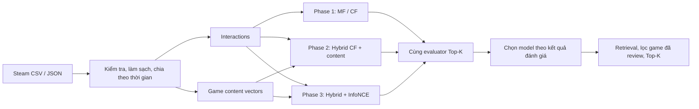

# Kiến trúc hệ thống gợi ý game Steam

Tài liệu này là kiến trúc thống nhất của dự án. [project.md](project.md) mô tả công việc và tiêu chí hoàn thành của từng phase. Ba phase là **ba thí nghiệm kế tiếp nhau**, không phải ba bộ lọc chạy nối tiếp khi phục vụ một yêu cầu gợi ý.

## 1. Bài toán và dữ liệu

Với lịch sử review đã biết của một user, hệ thống xếp hạng các game mà user **chưa review tại thời điểm gợi ý** và trả về Top-K game có khả năng được họ đánh giá tích cực. Dataset không có danh sách đầy đủ game đã mua/chơi, nên không thể bảo đảm mọi game được gợi ý là game user chưa từng chơi.

| Tệp gốc trong `data/` | Vai trò |
|---|---|
| `recommendations.csv` | Review `(user_id, app_id, date, is_recommended, hours, ...)`; nguồn tương tác chính |
| `games.csv` | Catalog, ngày phát hành và thuộc tính game |
| `games_metadata.json` | Description và tags để tạo biểu diễn nội dung |
| `users.csv` | `products` và `reviews` là **số lượng**, không phải danh sách game hoặc hồ sơ nhân khẩu học |

Theo `data/dataset_report.txt`: 50.872 game, 41.154.794 review, 13.781.059 user có review, 37.610 game có review. Có 10.373 game thiếu description và 1.229 game thiếu cả description lẫn tags. Các con số này là thống kê của dataset hiện tại, không phải kết quả sau khi lọc train; đường dẫn `archive/` ghi bên trong báo cáo là đường dẫn cũ, không phải vị trí file hiện nay.

Quy ước nhãn: review `is_recommended=True` là positive; `False` là explicit negative đối với **game đó**; cặp user-game không có review là **unknown**, không tự động mang nhãn 0. `hours` không thay đổi nhãn; có thể thử dùng làm trọng số sau khi có baseline.

## 2. Kiến trúc tổng thể



Popularity là mốc tham chiếu không cá nhân hóa. Chọn cấu hình và mô hình theo validation, sau đó dùng test một lần để báo cáo kết quả cuối; không mặc định Phase 3 sẽ thắng. Không có cascade `CF Top-K → content → contrastive`: một game bị loại sớm bởi CF sẽ mất cơ hội được content hỗ trợ.

## 3. Giao thức dữ liệu dùng chung

1. Đọc dữ liệu theo batch hoặc bằng DuckDB; chuyển interaction đã làm sạch sang Parquet. Kiểm tra trùng theo `(user_id, app_id)`, không chỉ theo `review_id`; ghi quy tắc xử lý review lặp. Nếu dedup chọn review đại diện, quyết định tại mỗi snapshot chỉ được dựa trên các review đã có đến cutoff của snapshot, không chọn bản ghi tương lai rồi đưa ngược vào train. Dữ liệu gốc ở `data/` là bất biến; Parquet tạo mới nằm trong `data/processed/`.
2. Chia theo hai mốc thời gian `T1 < T2`. **Validation snapshot:** train với review `date ≤ T1`, dự đoán positive trong `(T1,T2]`. Chọn hyperparameter bằng validation. **Test snapshot:** giữ nguyên cấu hình đã chọn, retrain từng model trên review `date ≤ T2`, rồi dự đoán positive `date > T2`. Test chỉ dùng để báo cáo cuối, không chọn lại cấu hình. Mỗi snapshot có mapping ID, popularity, negative sampler và checkpoint fit từ dữ liệu đã có đến cutoff của chính snapshot; không dùng review tương lai.
3. Tại cutoff `T ∈ {T1,T2}`, tập ứng viên là toàn bộ game trong catalog có `date_release ≤ T` và ngày phát hành hợp lệ; loại game user đã review với `date ≤ T`, không loại game chỉ được review sau `T`. Đánh giá một lần/user/snapshot: user phải có ít nhất một positive trong lịch sử `date ≤ T` và ít nhất một positive hợp lệ trong cửa sổ tương lai. Target là tập game positive tương lai còn trong tập ứng viên; ghi số target bị loại vì chưa phát hành tại `T` hoặc thiếu metadata ngày. Lập ánh xạ ID liên tục riêng cho dữ liệu train của từng snapshot; user/game unseen không được ép vào embedding ID chưa học.
4. Tránh đưa `positive_ratio`, `user_reviews`, `rating`, `helpful`, `funny` vào đặc trưng lịch sử nếu chúng được tổng hợp sau mốc train. TF-IDF/SVD nếu phải fit thì chỉ fit trên nội dung game đủ điều kiện tại cutoff tương ứng; text encoder pretrained chỉ dùng suy luận. Description/tags của bộ dữ liệu là một snapshot hiện tại, không phải snapshot lịch sử; ghi rõ đây là giới hạn không thể loại bỏ hoàn toàn khi đánh giá theo thời gian.
5. **Thí nghiệm chính** dùng cùng nguồn negative cho mọi phase: review `False` của chính user đã có trước cutoff và game chưa review lấy ngẫu nhiên từ catalog hợp lệ tại cutoff. Unknown được lấy mẫu chỉ là negative giả định với trọng số thấp hơn explicit `False`. Sinh mẫu theo quy tắc xác định được từ `seed`, snapshot, epoch và khóa positive/user để các model dùng cùng nguồn mẫu mà không phải lưu toàn bộ cặp âm. Không dùng review validation/test để xác nhận một unknown là negative tại cutoff train.
6. **Ablation semantic semi-hard** là thí nghiệm riêng: thêm unknown có độ tương đồng nội dung vừa phải, tránh nhóm gần positive nhất vì nguy cơ false negative. Chạy lại các model đối chứng với cùng sampler semantic nếu muốn quy cải thiện cho loss/kiến trúc; không trộn kết quả này vào bảng thí nghiệm chính. Khoảng top 5–20% chỉ là điểm khởi đầu để chọn bằng validation.

Việc dùng chung split, định nghĩa sampler, tập ứng viên và evaluator giúp xác định tác dụng của thành phần được thêm ở từng phase. Lưu seed, phiên bản sampler, cutoff, quy tắc dedup, số dòng sau lọc và checksum/định danh dữ liệu trong manifest nhỏ ở `experiments/`; không bắt buộc materialize toàn bộ negative pool của hàng chục triệu review.

## 4. Phase 1 — Collaborative Filtering bằng Matrix Factorization

Mô hình học hai bảng vector: `U[user_id]` và `V[app_id]`, ví dụ mỗi vector có `d=64` chiều. Không tạo ma trận đặc `số_user × số_game`; mỗi batch chỉ đọc các dòng interaction cần dùng.

```text
user_id ─→ U[u] ─┐
                 ├─→ s1(u,i) = U[u] · V[i] / sqrt(d)
app_id  ─→ V[i] ─┘
```

`MF + BCE` là baseline dễ kiểm tra với nhãn review nhị phân. Với logit `s`, nhãn `y ∈ {0,1}` và trọng số mẫu `w`, loss là `−w[y log σ(s) + (1−y) log(1−σ(s))]` cộng regularization. Review `False` có độ tin cậy cao hơn game chưa review được lấy mẫu. Một baseline ranking mạnh hơn dùng **BPR** trên `(u, positive p, negative n)`: `−log σ(s1(u,p)−s1(u,n))`. MF là kiến trúc; BCE và BPR là hai cách huấn luyện cùng kiến trúc đó.

Đầu ra: checkpoint MF, vector user/game và bảng kết quả Popularity, MF+BCE, MF+BPR. Item không có tương tác train chưa có vector ID hữu ích.

## 5. Phase 2 — Hybrid CF + Content

Tạo vector nội dung cố định `c_i` từ description và tags của mỗi game bằng TF-IDF + TruncatedSVD hoặc một text encoder có sẵn. Lần đầu nên tính trước và đóng băng text encoder. Một lớp chiếu `W` đưa vector dense `c_i` về cùng kích thước với `V[i]`:

```text
game text/tags ─→ c_i ─→ W c_i ─┐
app_id         ─→ V[i] ─────────┼─→ g_i = V[i] + W c_i
user_id        ─→ U[u] ─────────┴─→ s2(u,i) = U[u] · g_i / sqrt(d)
```

Huấn luyện `U`, `V`, `W` với **cùng BCE, cùng mẫu train và negative như Phase 1**. Có thể khởi tạo `U,V` từ Phase 1 rồi fine-tune; khi đó cho baseline CF train tiếp cùng số bước để kiểm soát lợi thế do thời gian huấn luyện. Dùng ID dropout cho một tỷ lệ game khi train để nhánh content hoạt động ngay cả khi `V[i]` không sẵn có.

Với game mới: `V[i]=0`, nên `g_i=W c_i`. Nếu cả description và tags đều thiếu, cần fallback popularity/metadata và đánh dấu thiếu content; không tuyên bố xử lý được mọi game mới. **Hybrid+BPR là đối chứng bắt buộc** trước Phase 3 để kiểm tra liệu InfoNCE có hơn một loss ranking mạnh trên cùng hybrid tower hay không.

Đầu ra: checkpoint hybrid, content vectors và chênh lệch metric so với CF trên cùng test, đặc biệt ở game ít review và nhóm cold item giả lập.

## 6. Phase 3 — Hybrid với Contrastive Learning

Giữ **nguyên user tower và game tower của Phase 2**. Thay mục tiêu huấn luyện bằng so sánh một positive với nhiều negative. Với `q(u,i)=s2(u,i)/τ`, trong đó `τ>0` là temperature:

```text
L_InfoNCE(u,p,N) = -log [ exp(q(u,p)) /
                         (exp(q(u,p)) + Σ_{n∈N} w_n exp(q(u,n))) ]
```

`N` lấy từ cùng nguồn sampler chính ở mục 3. Có thể không có explicit negative đối với một user; không tạo nhãn `False` giả. Trọng số `w_n` và `τ` được chọn bằng validation. Tránh in-batch negatives chưa được lọc vì có thể coi game user thật sự thích là mẫu âm.

Với **chỉ một negative và trọng số 1**, InfoNCE tương đương BPR sau khi đổi thang điểm bằng `τ`. Vì vậy cần nhiều negative và so sánh Phase 3 với cả `Hybrid+BCE` lẫn `Hybrid+BPR` dùng nguồn mẫu tương đương; không gọi mọi cải thiện là do “contrastive” nếu đồng thời thay sampler hoặc số lượng negative.

Đầu ra: checkpoint contrastive, bảng so sánh đầy đủ và ablation theo nguồn negative/temperature.

## 7. Đánh giá

Evaluator xếp hạng **toàn bộ** game hợp lệ tại cutoff `T1` hoặc `T2`, loại game user **đã review đến cutoff**, và kiểm tra tập positive ở cửa sổ tiếp theo. Không lọc game bằng review tương lai, vì như vậy có thể loại đáp án đúng. Đánh giá tất cả user đủ điều kiện theo mục 3, không chọn cohort test cố định thay cho kết quả chính. Chấm điểm theo batch user/game, giữ Top-K từng batch; không tạo ma trận đặc `số_user × số_game`. Với nhiều target/user, `Recall@K` là tỷ lệ target xuất hiện trong Top-K, còn `NDCG@K` chuẩn hóa theo số target hợp lệ của user.

Metric chính: `Recall@10/20`, `NDCG@10/20`; bổ sung HitRate@K, catalog coverage, AUC/log loss cho các cặp review có nhãn thật nếu cần. Chạy riêng các nhóm: warm user, user ít review, game ít review, cold item giả lập. Cold item giả lập được tạo bằng cách giấu tương tác train của cùng một nhóm game cho mọi model nhưng giữ content để kiểm tra; game không có review nào không có ground truth offline. Báo cáo số user/target đủ điều kiện, target không thể xếp hạng ở cutoff và thời gian đánh giá. Không so trực tiếp metric full-catalog với sampled ranking.

| So sánh | Câu hỏi |
|---|---|
| MF+BCE → Hybrid+BCE | Content đóng góp gì? |
| MF+BPR → Hybrid+BPR | Content có giúp khi tối ưu ranking không? |
| Hybrid+BCE/BPR → Hybrid+InfoNCE | Mục tiêu contrastive nhiều negative có cải thiện không? |

## 8. Phục vụ và cold start

```text
User đã có embedding ID → chấm điểm game hợp lệ → loại game đã review → Top-K
User mới, chưa chọn gì → danh sách popularity mặc định
User mới, chọn 2–3 game/tags → gợi ý theo độ tương đồng content
Game mới có content → vector W c_i → có thể tham gia candidate set
```

Luồng user mới dựa trên content là một nhánh onboarding; vector trung bình của các game **không tự động là vector user MF đã được train**. Nếu muốn user mới dùng chính model hybrid, phải bổ sung user history encoder hoặc fold-in có đánh giá riêng. Dataset không có danh sách click, session, game sở hữu hay demographic để huấn luyện các nhánh đó từ dữ liệu hiện tại.

Checkpoint huấn luyện và **bundle phục vụ** là hai đầu ra khác nhau. Sau khi chọn model, bundle có version gồm user/item embeddings hoặc tham số cần để tính chúng, ánh xạ ID, catalog và content vectors/encoder tương ứng, lịch sử game đã review để lọc, popularity fallback và manifest ghi cutoff, config, seed, phiên bản dữ liệu/model. Demo local chỉ tải bundle này, không đọc lại toàn bộ CSV review; có thể đọc từng phần user embeddings lớn từ đĩa và giữ item vectors nhỏ trong bộ nhớ. Với user chưa có embedding dùng popularity hoặc lựa chọn game/tags khi onboarding; với game không có ID embedding nhưng có content, chỉ Phase 2/3 dùng `Wc_i`; game thiếu cả content dùng fallback và ghi rõ hạn chế. Chấm điểm trực tiếp trên catalog khoảng 50 nghìn game trước khi thêm FAISS; không bắt buộc PostgreSQL/pgvector, Qdrant hay LLM. Knowledge Graph và session-based recommender không thuộc kiến trúc chính vì thiếu dữ liệu cần thiết.

## 9. Cấu trúc thư mục đề xuất

```text
steam-recommendation-system/
├── AGENTS.md                  # Quy tắc cho agent làm việc trong dự án
├── README.md                  # Cách cài đặt, chuẩn bị dữ liệu, chạy thí nghiệm
├── architecture.md            # Kiến trúc và giao thức đánh giá
├── project.md                 # Kế hoạch và tiêu chí hoàn thành từng phase
├── requirements.txt           # Phụ thuộc Python được khóa khi triển khai
├── configs/
│   ├── data.yaml              # Đường dẫn, T1/T2, seed và quy tắc dữ liệu
│   ├── mf.yaml                # Phase 1: MF+BCE/BPR
│   ├── hybrid.yaml            # Phase 2: Hybrid+BCE/BPR
│   └── contrastive.yaml       # Phase 3: Hybrid+InfoNCE
├── data/
│   ├── *.csv, *.json          # CSV/JSON gốc hiện có; giữ nguyên
│   ├── dataset_report.txt     # Báo cáo dữ liệu hiện có
│   ├── processed/            # Parquet đã làm sạch, ID mappings, content vectors
│   └── splits/               # Dữ liệu theo T1/T2; sampler tái lập từ config/seed
├── src/steamrec/
│   ├── data/                 # Làm sạch, split, negative sampling
│   ├── features/             # TF-IDF/SVD hoặc text embeddings của game
│   ├── models/
│   │   ├── mf.py             # Kiến trúc Phase 1
│   │   └── hybrid.py         # Kiến trúc chung của Phase 2 và 3
│   ├── losses/               # BCE, BPR, InfoNCE
│   ├── training/             # Train loop và checkpoint
│   ├── evaluation/           # Full-catalog metrics và phân tích cold item
│   └── serving/              # Top-K, lọc game đã review, fallback cold start
├── scripts/                  # Entrypoint: prepare_data, build_content, train, evaluate
├── experiments/              # Manifest nhỏ, config và bảng kết quả từng lần chạy
├── artifacts/                # Checkpoints và bundle phục vụ; không commit Git
├── notebooks/                # Khám phá dữ liệu và phân tích kết quả
└── tests/                    # Unit/integration tests cho pipeline và metrics
```

Đây là **cấu trúc đích**, không yêu cầu tạo ngay mọi thư mục rỗng hoặc di chuyển các CSV lớn đang nằm trực tiếp trong `data/`. Các script lấy đường dẫn từ config; dữ liệu Parquet mới nằm trong `data/processed/` và `data/splits/`. Toàn bộ `data/` hiện bị `.gitignore` bỏ qua, nên manifest/config/metric nhỏ cần theo dõi phiên bản phải ở `experiments/` hoặc `configs/`, không chỉ nằm trong `data/`. Notebook và script hiện có chỉ được chuyển khi đã kiểm tra chúng còn được sử dụng và cập nhật đường dẫn liên quan.

Tổ chức `src/` theo thành phần dùng chung để ba phase dùng **cùng** split, negative sampler và evaluator. Phase 3 không cần một model tower mới: dùng `models/hybrid.py` của Phase 2 và đổi loss/batch huấn luyện. Nếu thêm SASRec sau này, báo cáo nó trên nhóm user đủ lịch sử và so các baseline trên đúng nhóm đó trong bảng phụ; không trộn với bảng full-user chính và không thay thế ba phase.

## 10. Tech stack và phạm vi sử dụng

| Nhu cầu | Công nghệ | Khi nào dùng |
|---|---|
| Xử lý `recommendations.csv` lớn, join và chia dữ liệu | Python + DuckDB | Bước chuẩn bị dữ liệu; DuckDB là công cụ xử lý/truy vấn, không phải định dạng lưu trữ |
| Lưu dữ liệu sạch và split | Parquet; PyArrow khi cần đọc/ghi batch trong Python | Đầu ra của bước chuẩn bị và đầu vào cho training; giữ CSV/JSON gốc nguyên trạng |
| Huấn luyện MF/Hybrid/InfoNCE | PyTorch (`nn.Embedding`, `DataLoader`, autograd) | Cả ba phase; ưu tiên batch/streaming và đo bộ nhớ trước khi dùng toàn bộ user |
| Tạo `c_i` từ description/tags | scikit-learn TF-IDF + TruncatedSVD ban đầu; Sentence Transformers là phương án thử thêm | Phase 2/3; TF-IDF thuần là vector thưa, cần giảm chiều hoặc dùng encoder tạo vector dense trước khi đưa vào `Wc_i` |
| Tính metric và kiểm thử | NumPy + pytest | Một evaluator dùng chung; test split thời gian, lọc game đã review và Recall/NDCG |
| Tái lập thí nghiệm | YAML config, seed cố định, manifest và CSV/JSON kết quả, Git | Lưu cutoff, định nghĩa sampler, phiên bản content encoder, hyperparameter và định danh checkpoint theo từng run; không bắt buộc lưu mọi negative đã sinh |
| Demo local sau khi chọn model | Bundle phục vụ, NumPy và giao diện đơn giản; FastAPI nếu cần | Đọc artifact đã xuất thay vì CSV gốc, chấm điểm trực tiếp catalog trước khi thêm vector search |

Luồng mặc định: `CSV/JSON gốc → DuckDB làm sạch/chia tập → Parquet → PyTorch train/evaluate → checkpoint + bảng metric → bundle demo`. DuckDB và Parquet **bổ trợ nhau**, không phải hai lựa chọn thay thế. Với khoảng 13,8 triệu user có review, embedding user 64 chiều kiểu `float32` đã cần xấp xỉ 3,5 GB chỉ cho trọng số; gradient và optimizer còn tốn thêm bộ nhớ. Vì vậy chạy smoke test local trên mẫu nhỏ để kiểm tra pipeline, nhưng **kết quả cuối** train trên toàn bộ review hợp lệ của từng snapshot ở Kaggle/máy khác và đánh giá mọi user đủ điều kiện. Trước job lớn cần ước tính RAM/VRAM, dung lượng đĩa tạm và thời gian từ benchmark nhỏ; đọc Parquet theo batch, không tạo ma trận user-game đặc, lưu checkpoint có thể tiếp tục sau gián đoạn. Không giả định cấu hình mặc định của một môi trường cloud bất kỳ đủ bộ nhớ.

Không bắt buộc Spark, Kafka, FAISS, PostgreSQL/pgvector, Qdrant hay LLM. Chỉ bổ sung khi yêu cầu hoặc kết quả đo đạc về tốc độ/quy mô chứng minh cần thiết. `requirements.txt` hiện chưa có gói nào; khi bắt đầu code phải ghi phụ thuộc thực dùng và phiên bản tương thích, không cài cả stack mở rộng từ đầu. Tài liệu này quy định thiết kế, không khẳng định full-data training đã chạy hoặc demo đã hoạt động.
