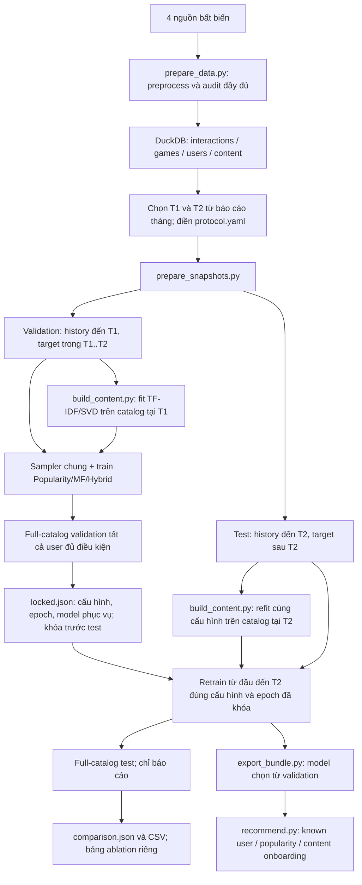
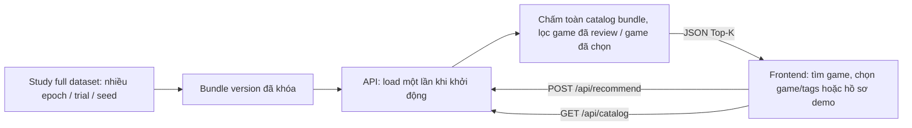

# Mã triển khai còn lại — Steam Recommendation System

Tài liệu này chứa **mã đầy đủ để chép vào từng file sau này**, cây thư mục và luồng thực thi cho Phase 1/2/3. Trong repo chỉ tạo/cập nhật `implementation-phases.md`; các file triển khai Python/YAML/frontend bên dưới chưa được tạo, chưa train dataset thật và chưa đo metric nghiên cứu. Đặc tả nghiên cứu vẫn do [architecture.md](architecture.md) sở hữu; tiêu chí hoàn thành ở [project.md](project.md). Các giá trị khởi đầu của thí nghiệm chỉ khai báo trong các khối config bên dưới.

**Bản rà soát theo yêu cầu mới:** job chính xử lý toàn bộ dataset nguồn, train qua toàn bộ lịch sử hợp lệ của từng snapshot ở mỗi epoch, chạy mọi family của ba phase qua nhiều seed, và đánh giá tất cả user đủ điều kiện trên toàn catalog. Batch là cách chia dữ liệu để vừa bộ nhớ; không phải lấy một batch làm tập train. Một lần gọi script có thể điều phối nhiều epoch, trial và lần lặp độc lập. Phần UI/API/frontend ở mục 13 là mở rộng được người dùng yêu cầu cho giai đoạn sau; không thay giao thức nghiên cứu, không tạo frontend ngoài file Markdown này.

## 1. Phần đã có và phần bổ sung

**Cập nhật trạng thái (2026-11-22):** preprocess toàn bộ đã chạy (manifest `experiments/manifests/preprocess.json`); T1/T2 đã điền trong `configs/protocol.yaml`. **Cập nhật 2026-11-27:** Phase 1–2 đã có mã trong repo (khác bản nháp dưới đây ở các điểm sau): `common/utils.py` (+ re-export trong `common/__init__.py`), `data/{snapshot,sampling}.py`, `evaluation/ranking.py` (chấm cả batch user bằng một phép nhân ma trận, item vector tính một lần), `features/content.py`, `models/{matrix_factorization,hybrid}.py`, `losses/objectives.py` (chỉ BCE/BPR; InfoNCE để Phase 3), `training/{engine,suite}.py` (không resume giữa epoch; validation không lưu checkpoint, test lưu khi có `--save-checkpoints`), scripts `prepare_snapshots`, `build_content`, `estimate_resources`, `run_experiments`, configs `mf.yaml`/`hybrid.yaml`, tests trên fixture. Chưa chạy snapshot/train trên dữ liệu thật. Trên fixture tổng hợp, `learning_rate: 0.05` gần như không học (loss 0.6931→0.6930 sau 10 epoch); cần dò lr bằng validation trước khi train chính.

Giữ nguyên `src/steamrec/data/{io,clean,validate,split,manifest}.py`, `scripts/prepare_data.py`, các test preprocess và các công cụ audit/catalog hiện có. Pipeline preprocess đã có mã không đồng nghĩa đã kiểm chứng chạy toàn bộ dữ liệu. `data/processed/steamrec.duckdb` hiện có trên đĩa, nhưng phải kiểm tra manifest và bốn bảng trước khi dùng; không tự ghi đè database.

`split.py` hiện chứa `deduplicate_history(con, cutoff)`: lọc cutoff **trước** dedup, dừng khi nhãn trái nhau ở ngày mới nhất. Mã mới dùng trực tiếp helper này, không thay thế nó. `manifest.py` hiện có `fingerprint` và `write_manifest`; mã mới dùng lại.

Đường dẫn CSV/JSON giữa AGENTS và tài liệu có khác biệt: AGENTS nhắc `data/`, còn `architecture.md`, `project.md` và `configs/data.json` dùng `data/raw/`; thư mục hiện tại có `data/raw/`. Luồng bổ sung chỉ đọc database preprocess theo config, không di chuyển hay sửa nguồn. Nếu nguồn thực tế ở vị trí khác, sửa config nguồn trong một lần triển khai riêng.

## 2. Cây thư mục đích

Ký hiệu `[có]`: đã tồn tại; `[mới]`: mã nằm trong tài liệu này; `[sinh]`: chỉ tạo khi chạy sau này. Không cần tạo thư mục rỗng trước.

```text
steam-recommendation-system/
├── AGENTS.md                                      [có]
├── architecture.md                                [có]
├── project.md                                     [có]
├── implementation-phases.md                       [file bàn giao này]
├── pyproject.toml                                 [có, giữ nguyên]
├── requirements.txt                               [có, giữ nguyên]
├── requirements-models.txt                        [mới]
├── configs/
│   ├── data.json                                  [có]
│   ├── catalog.json                               [có]
│   ├── protocol.yaml                             [mới]
│   ├── mf.yaml                                   [mới]
│   ├── hybrid.yaml                               [mới]
│   ├── contrastive.yaml                          [mới]
│   └── serving.yaml                              [mới, UI tùy chọn]
├── src/steamrec/
│   ├── __init__.py                                [có]
│   ├── common.py                                 [mới]
│   ├── data/
│   │   ├── __init__.py                            [có]
│   │   ├── io.py / clean.py / validate.py          [có]
│   │   ├── split.py / manifest.py                 [có]
│   │   ├── snapshot.py                           [mới]
│   │   └── sampling.py                           [mới]
│   ├── features/
│   │   ├── __init__.py                            [mới]
│   │   └── content.py                            [mới]
│   ├── models/
│   │   ├── __init__.py                            [mới]
│   │   ├── mf.py                                 [mới]
│   │   └── hybrid.py                             [mới; Phase 2 và 3 cùng dùng]
│   ├── losses/
│   │   ├── __init__.py                            [mới]
│   │   └── objectives.py                         [mới]
│   ├── training/
│   │   ├── __init__.py                            [mới]
│   │   ├── engine.py                             [mới]
│   │   ├── suite.py                              [mới]
│   │   └── study.py                              [mới, nhiều seed]
│   ├── evaluation/
│   │   ├── __init__.py                            [mới]
│   │   └── ranking.py                            [mới]
│   └── serving/
│       ├── __init__.py                            [mới]
│       ├── bundle.py                             [mới]
│       └── api.py                                [mới, UI tùy chọn]
├── scripts/
│   ├── prepare_data.py / prepare_catalog.py        [có]
│   ├── audit_pairs_dates.py / check_game.py        [có]
│   ├── prepare_snapshots.py                       [mới]
│   ├── build_content.py                           [mới]
│   ├── estimate_resources.py                      [mới]
│   ├── run_experiments.py                         [mới]
│   ├── run_pipeline.py                            [mới, điều phối toàn bộ]
│   ├── export_bundle.py                           [mới]
│   ├── recommend.py                               [mới, demo CLI]
│   └── serve_api.py                               [mới, UI tùy chọn]
├── tests/
│   ├── test_preprocess.py / test_prepare_catalog.py [có]
│   ├── test_research_protocol.py                  [mới]
│   ├── test_full_study.py                         [mới]
│   └── test_serving_api.py                        [mới, UI tùy chọn]
├── requirements-serving.txt                       [mới, UI tùy chọn]
├── frontend/                                      [mới, UI tùy chọn]
│   ├── index.html
│   ├── app.js
│   └── styles.css
├── data/raw/                                      [có; bất biến]
├── data/processed/                                [có; không ghi đè]
├── data/splits/<experiment>/<validation|test>/     [sinh; Git ignore data/]
├── experiments/
│   ├── manifests/<experiment>-<snapshot>.json     [sinh; nhỏ, theo dõi Git]
│   ├── runs/<study>/                              [sinh; study nhiều seed]
│   │   ├── resources.json / study-started.json
│   │   └── study-locked.json / study-test.json / study-test.csv
│   └── runs/<study>-seed-<seed>/                   [sinh; một seed]
│       ├── validation.csv / test.csv
│       ├── locked.json / test-locked.json / comparison.json
│       └── <validation|test>/<trial>/epoch-*.json [log nhỏ]
└── artifacts/                                     [sinh; bổ sung Git ignore]
    ├── checkpoints/<run>/<validation|test>/<trial>/epoch-*.pt
    └── bundles/<version>/                         [demo đọc ở đây]
```

Các `__init__.py` mới có cùng nội dung sau, mỗi thư mục một file:

```python
"""Shared Steam recommendation components."""
```

Khi thực sự triển khai, bổ sung `/artifacts/` vào `.gitignore`; giữ manifest/config/CSV metric nhỏ trong Git. Không chép hàng triệu dòng per-user metric vào `experiments/`.

## 3. Luồng thực thi và trách nhiệm



Ba phase là ba nhóm thí nghiệm, **không phải cascade**. Phase 1 chạy Popularity, MF+BCE, MF+BPR. Phase 2 chạy Hybrid+BCE và Hybrid+BPR với cùng sampler/ngân sách. Phase 3 dùng chính `Hybrid` và thay loss bằng InfoNCE nhiều negative. Mỗi epoch validation có thể dùng toàn bộ evaluator để chọn epoch; test không early stop hay chọn model.

`main`, `cold`, `semantic`, `explicit` là các run riêng. Cold giả lập chọn game bằng hash từ catalog tại **T1 có review train**, dùng lại danh sách ở T2, giấu interaction train của chúng cho mọi model; vẫn giữ lịch sử thực để lọc game đã review và không biến game bị giấu thành negative. Cohort cold dùng user có positive còn lại sau giấu; báo số user bị mất. Semantic là ablation riêng và chạy lại cả MF/Hybrid đối chứng. Explicit-only không tự thêm unknown khi user không có review False: log số positive không có negative; không so loss training này như thể có cùng số ví dụ với main.

Các bảng train có review catalog-orphan hoặc review trước release vẫn được giữ để học ID nếu hợp lệ; chúng không tự trở thành candidate. Mapping model item chỉ cấp embedding cho item xuất hiện trong train. Một chỉ số `item_idx` chung cho catalog + train orphan là **chỉ số lưu trữ**, khác với `embedding_idx`; item unseen có `embedding_idx=0`, vector ID đúng bằng zero. Đánh giá không học từ target.

Sampler không xem target. BCE đọc **mọi review False** một lần/epoch, kể cả user chỉ có False; phần positive có cùng negative pool với BPR/InfoNCE. Với BCE, explicit False đã có ở nhánh review nên không đếm lại chúng ở nhánh sampled negative. BPR/InfoNCE dùng explicit False khi ghép với positive; False-only user không có pairwise supervision. Đây là khác biệt tự nhiên của objective, được ghi trong manifest; không gọi unknown là nhãn thật.

## 4. Config và dependencies

### `requirements-models.txt`

Không thay dependency preprocess đã có. Các khoảng phiên bản dưới đây là ràng buộc triển khai, **chưa phải lock môi trường đã kiểm chứng**. Sau khi cài trên máy train, lưu `pip freeze` và phiên bản runtime trong manifest; chọn build PyTorch phù hợp CPU/CUDA trên máy đó.

```text
-r requirements.txt
numpy>=1.26,<3
pyarrow>=16,<24
scikit-learn>=1.4,<2
torch>=2.3,<3
PyYAML>=6,<7
pytest>=8,<10
psutil>=5.9,<8
joblib>=1.3,<2
```

### `configs/protocol.yaml`

`T1/T2: null` là chủ ý: chương trình dừng cho đến khi người triển khai chọn từ manifest tháng. Không có ngày giả được trình bày như quyết định nghiên cứu. Config này sở hữu đường dẫn, sampler và ngân sách chung; các config model chỉ sở hữu kiến trúc/loss và trial riêng.

```yaml
version: 1
T1: null
T2: null
seed: 42
scope: full
repetition:
  seeds: [42, 43, 44]
paths:
  database: data/processed/steamrec.duckdb
  preprocess_manifest: experiments/manifests/preprocess.json
  splits: data/splits
  manifests: experiments/manifests
  reports: experiments/runs
  checkpoints: artifacts/checkpoints
  bundles: artifacts/bundles
execution:
  memory_limit: 2GB
  threads: 2
  temporary_directory: data/processed/tmp/snapshots
  device: cpu
  batch_size: 1024
  item_batch_size: 2048
  user_batch_size: 128
  epochs: 3
  checkpoint_every_batches: 1000
  learning_rate: 0.05
  l2: 0.00001
  embedding_dimension: 64
  max_grad_norm: 5.0
  benchmark_batches: 20
sampler:
  version: keyed-v1
  explicit_count: 2
  unknown_count: 6
  explicit_weight: 1.0
  unknown_weight: 0.25
  mode: mixed
  semantic_low: 0.05
  semantic_high: 0.20
  semantic_fraction: 0.5
content:
  dimensions: 128
  max_features: 50000
  ngram_range: [1, 2]
  min_df: 1
evaluation:
  ks: [10, 20]
  selection_metric: NDCG@10
  sparse_user_max: 3
  sparse_item_max: 5
cold:
  fraction: 0.1
```

### `configs/mf.yaml`

```yaml
architecture: mf
trials:
  - {name: mf-bce, objective: bce}
  - {name: mf-bpr, objective: bpr}
```

### `configs/hybrid.yaml`

```yaml
architecture: hybrid
trials:
  - {name: hybrid-bce, objective: bce, id_dropout: 0.1}
  - {name: hybrid-bpr, objective: bpr, id_dropout: 0.1}
```

### `configs/contrastive.yaml`

```yaml
architecture: hybrid
trials:
  - {name: hybrid-infonce-t01, objective: infonce, id_dropout: 0.1, temperature: 0.1}
  - {name: hybrid-infonce-t05, objective: infonce, id_dropout: 0.1, temperature: 0.5}
```

Muốn search dimension/lr/L2, thêm trial có override các khóa đó, chạy lại **cả nhóm đối chứng** trong run tương ứng. Không thay số negative hoặc số epoch riêng cho InfoNCE rồi quy cải thiện cho loss. Không warm-start giữa phase trong bản này, nên không có lợi thế do fine-tune thêm bước.

## 5. Các module dùng chung

### `src/steamrec/common.py`

```python
import hashlib
import json
import platform
import re
import time
import uuid
from datetime import date
from pathlib import Path

import numpy as np
import yaml

from steamrec.data.manifest import fingerprint, write_manifest


def identifier(value):
    value = str(value)
    if not re.fullmatch(r"[A-Za-z0-9][A-Za-z0-9_-]*", value):
        raise ValueError(f"Unsafe name: {value!r}")
    return value


def read_yaml(path):
    return yaml.safe_load(Path(path).read_text(encoding="utf-8-sig"))


def read_json(path):
    return json.loads(Path(path).read_text(encoding="utf-8"))


def digest(value):
    raw = json.dumps(value, sort_keys=True, separators=(",", ":"), default=str)
    return hashlib.sha256(raw.encode()).hexdigest()


def keyed_seed(*parts):
    return int(digest(list(parts))[:16], 16)


def base_protocol(config):
    return {key: value for key, value in config.items() if key != "run_seed"}


def training_seed(config):
    return int(config.get("run_seed", config["seed"]))


def protocol(path):
    config = read_yaml(path)
    if config.get("T1") is None or config.get("T2") is None:
        raise ValueError("Choose T1/T2 from preprocess monthly report first")
    t1, t2 = (date.fromisoformat(str(config[k])) for k in ("T1", "T2"))
    if t1 >= t2:
        raise ValueError("T1 must be before T2")
    config["T1"], config["T2"] = t1.isoformat(), t2.isoformat()
    if config["scope"] not in {"full", "smoke"}:
        raise ValueError("scope must be full or smoke")
    seeds = config["repetition"]["seeds"]
    if (len(seeds) < 2 or len(set(seeds)) != len(seeds) or
            any(isinstance(seed, bool) or not isinstance(seed, int) or seed < 0 for seed in seeds)):
        raise ValueError("Repeated full study needs at least two distinct nonnegative seeds")
    s = config["sampler"]
    if s["version"] != "keyed-v1":
        raise ValueError("Unsupported sampler version")
    if min(s["explicit_count"], s["unknown_count"]) < 0:
        raise ValueError("Negative counts must be nonnegative")
    if not 0 < s["unknown_weight"] < s["explicit_weight"]:
        raise ValueError("Unknown weight must be positive and below explicit weight")
    if not 0 <= s["semantic_low"] < s["semantic_high"] <= 1:
        raise ValueError("Invalid semantic quantile band")
    if not 0 <= s["semantic_fraction"] <= 1:
        raise ValueError("Invalid semantic fraction")
    if not 0 < config["cold"]["fraction"] < 1:
        raise ValueError("Cold fraction must be in (0,1)")
    e = config["execution"]
    for key in ("threads", "batch_size", "item_batch_size", "user_batch_size",
                "epochs", "embedding_dimension", "benchmark_batches"):
        if not isinstance(e[key], int) or isinstance(e[key], bool) or e[key] <= 0:
            raise ValueError(f"Invalid {key}")
    if e["checkpoint_every_batches"] < 0 or e["learning_rate"] <= 0 or e["l2"] < 0:
        raise ValueError("Invalid optimizer/checkpoint configuration")
    ks = config["evaluation"]["ks"]
    if not ks or any(not isinstance(k, int) or k <= 0 for k in ks):
        raise ValueError("ks must be positive integers")
    if config["evaluation"]["selection_metric"] not in {
        f"{name}@{k}" for name in ("Recall", "NDCG", "HitRate") for k in ks
    }:
        raise ValueError("Selection metric is not computed by evaluator")
    return config


def output_directory(path):
    path = Path(path)
    path.mkdir(parents=True, exist_ok=False)
    return path


def save_array(path, array):
    with Path(path).open("xb") as handle:
        np.save(handle, array, allow_pickle=False)


def runtime():
    import duckdb
    import pyarrow
    import sklearn
    import torch
    import psutil
    return {
        "python": platform.python_version(), "numpy": np.__version__,
        "duckdb": duckdb.__version__, "pyarrow": pyarrow.__version__,
        "sklearn": sklearn.__version__, "torch": torch.__version__,
        "cuda": torch.version.cuda, "rss_bytes": psutil.Process().memory_info().rss,
        "timestamp_unix": time.time(),
    }


def artifact_hashes(directory):
    return {p.name: fingerprint(p) for p in sorted(Path(directory).iterdir()) if p.is_file()}


def record(path, value):
    path = Path(path)
    if path.exists():
        raise FileExistsError(path)
    partial = path.with_name(path.name + ".partial-" + uuid.uuid4().hex)
    write_manifest(partial, value)
    # rename refuses an existing destination on Windows; explicit guard also covers other OS.
    if path.exists():
        raise FileExistsError(path)
    partial.rename(path)


def record_or_verify(path, value):
    path = Path(path)
    if path.is_file():
        if digest(read_json(path)) != digest(value):
            raise ValueError(f"Existing record has a different identity: {path}")
        return
    record(path, value)
```

### `src/steamrec/data/snapshot.py`

Database nguồn mở read-only. Bảng tính toán là TEMP; không thêm bảng vào database preprocess. Đăng ký relation lịch sử bằng `query` vì method này tạo temporary view theo [mã nguồn DuckDB Python](https://github.com/duckdb/duckdb-python/blob/main/src/pyrelation.cpp); không dùng `create_view` mặc định có thể tạo view bền vững. Parquet được xuất rồi đọc theo batch. CSR lưu mảng trên đĩa để tránh dictionary Python cho hàng triệu user. `targets` chỉ dùng evaluator, tuyệt đối không dùng sampler/train.

```python
from pathlib import Path

import duckdb
import numpy as np
import pyarrow.parquet as pq

from steamrec.common import (artifact_hashes, digest, keyed_seed, output_directory,
                             read_json, record, save_array)
from steamrec.data.io import sql_path
from steamrec.data.manifest import fingerprint
from steamrec.data.split import deduplicate_history


def export(con, query, destination):
    destination = Path(destination)
    if destination.exists():
        raise FileExistsError(destination)
    con.execute(f"COPY ({query}) TO {sql_path(destination)} "
                "(FORMAT PARQUET, COMPRESSION ZSTD)")


def csr_from_parquet(source, prefix, n_users, user_column="user_idx"):
    """Input must be ordered by user_idx, item_idx; preserve zero-length users."""
    source, prefix = Path(source), Path(prefix)
    counts = np.zeros(n_users, dtype=np.int64)
    parquet = pq.ParquetFile(source)
    for batch in parquet.iter_batches(columns=[user_column]):
        users = batch.column(0).to_numpy(zero_copy_only=False)
        np.add.at(counts, users, 1)
    offsets = np.empty(n_users + 1, dtype=np.int64)
    offsets[0] = 0
    np.cumsum(counts, out=offsets[1:])
    save_array(str(prefix) + "_offsets.npy", offsets)
    size = int(offsets[-1])
    values = np.lib.format.open_memmap(str(prefix) + "_items.npy", mode="w+",
                                      dtype=np.int64, shape=(size,))
    position = 0
    for batch in parquet.iter_batches(columns=["item_idx"]):
        data = batch.column(0).to_numpy(zero_copy_only=False)
        values[position:position + len(data)] = data
        position += len(data)
    values.flush()
    del values


def build_snapshot(config, experiment, stage, cold_app_ids=()):
    if stage not in {"validation", "test"}:
        raise ValueError(stage)
    cutoff = config["T1"] if stage == "validation" else config["T2"]
    end = config["T2"] if stage == "validation" else None
    root = Path(config["paths"]["splits"]) / experiment / stage
    manifest_path = Path(config["paths"]["manifests"]) / f"{experiment}-{stage}.json"
    if root.exists() or manifest_path.exists():
        raise FileExistsError("Snapshot or its manifest already exists")
    pre = read_json(config["paths"]["preprocess_manifest"])
    if config["scope"] == "full" and pre.get("scope") != "full; no LIMIT or sampling":
        raise ValueError("Full run requires a full preprocess manifest")
    database = Path(config["paths"]["database"])
    if not database.is_file():
        raise FileNotFoundError(database)
    declared_db = Path(pre["artifacts"]["database"]).resolve()
    if declared_db != database.resolve():
        raise ValueError("Preprocess manifest describes another database")
    temporary = Path(config["execution"]["temporary_directory"])
    temporary.mkdir(parents=True, exist_ok=True)
    root = output_directory(root)
    with duckdb.connect(str(database), read_only=True) as con:
        con.execute("SET memory_limit = ?", [config["execution"]["memory_limit"]])
        con.execute("SET threads = ?", [config["execution"]["threads"]])
        con.execute("SET temp_directory = ?", [str(temporary)])
        for name in ("interactions", "games", "users", "content"):
            count = con.execute(f"SELECT count(*) FROM {name}").fetchone()[0]
            if count != pre["counts"][name]["stored_rows"]:
                raise ValueError(f"Database row count disagrees with preprocess: {name}")
        history_relation = deduplicate_history(con, cutoff)
        history_relation.query("cutoff_view", "SELECT * FROM cutoff_view")
        # Materialize once as TEMP to avoid repeating a full dedup scan for each export/join.
        con.execute("CREATE TEMP TABLE history AS SELECT * FROM cutoff_view")
        con.execute("CREATE TEMP TABLE hidden(app_id BIGINT)")
        hidden = sorted(set(int(x) for x in cold_app_ids))
        if hidden:
            con.executemany("INSERT INTO hidden VALUES (?)", [(x,) for x in hidden])
        con.execute("""CREATE TEMP VIEW train_history AS SELECT h.* FROM history h
                       WHERE NOT EXISTS (SELECT 1 FROM hidden c WHERE c.app_id=h.app_id)""")
        con.execute("""CREATE TEMP TABLE user_map AS
            SELECT user_id, row_number() OVER (ORDER BY user_id)-1 AS user_idx,
                   count(*) AS review_count,
                   count(*) FILTER (WHERE is_recommended) AS positive_count
            FROM train_history GROUP BY user_id""")
        con.execute("""CREATE TEMP TABLE learned_items AS
            SELECT app_id, row_number() OVER (ORDER BY app_id) AS embedding_idx,
                   count(*) AS train_count,
                   count(*) FILTER (WHERE is_recommended) AS popularity
            FROM train_history GROUP BY app_id""")
        con.execute("""CREATE TEMP TABLE item_map AS
            WITH ids AS (
                SELECT app_id FROM games WHERE date_release <= CAST(? AS DATE)
                UNION SELECT app_id FROM history
            )
            SELECT ids.app_id, row_number() OVER (ORDER BY ids.app_id)-1 AS item_idx,
                   coalesce(l.embedding_idx,0) AS embedding_idx,
                   coalesce(l.train_count,0) AS train_count,
                   coalesce(l.popularity,0) AS popularity,
                   coalesce(g.date_release <= CAST(? AS DATE), false) AS candidate,
                   g.title, g.date_release, coalesce(c.text,'') AS text,
                   coalesce(c.missing_content,true) AS missing_content,
                   EXISTS(SELECT 1 FROM hidden x WHERE x.app_id=ids.app_id) AS cold
            FROM ids LEFT JOIN learned_items l USING(app_id)
            LEFT JOIN games g USING(app_id) LEFT JOIN content c USING(app_id)
        """, [cutoff, cutoff])
        n_users = con.execute("SELECT count(*) FROM user_map").fetchone()[0]
        n_items = con.execute("SELECT count(*) FROM item_map").fetchone()[0]
        if n_users == 0 or n_items == 0:
            raise ValueError("Empty training snapshot")
        export(con, "SELECT * FROM user_map ORDER BY user_idx", root / "users.parquet")
        export(con, "SELECT * FROM item_map ORDER BY item_idx", root / "items.parquet")
        export(con, """SELECT u.user_idx, i.item_idx, h.is_recommended AS label,
                       h.review_id FROM train_history h JOIN user_map u USING(user_id)
                       JOIN item_map i USING(app_id) ORDER BY h.review_id""", root / "train.parquet")
        export(con, """SELECT u.user_idx, i.item_idx FROM history h
                       JOIN user_map u USING(user_id) JOIN item_map i USING(app_id)
                       ORDER BY user_idx, item_idx""", root / "reviewed.parquet")
        export(con, """SELECT u.user_idx, i.item_idx FROM train_history h
                       JOIN user_map u USING(user_id) JOIN item_map i USING(app_id)
                       WHERE NOT h.is_recommended ORDER BY user_idx, item_idx""", root / "explicit.parquet")
        # Future positives are sets; contradictory latest labels are only resolved for history.
        con.execute("""CREATE TEMP TABLE future AS
            SELECT DISTINCT user_id, app_id FROM interactions
            WHERE is_recommended AND date > CAST(? AS DATE)
              AND (? IS NULL OR date <= CAST(? AS DATE))""", [cutoff, end, end])
        con.execute("""CREATE TEMP TABLE target_audit AS
            SELECT f.user_id, f.app_id, u.user_idx, i.item_idx,
                CASE
                  WHEN g.app_id IS NULL THEN 'missing_catalog'
                  WHEN g.date_release IS NULL THEN 'missing_release_date'
                  WHEN g.date_release > CAST(? AS DATE) THEN 'released_after_cutoff'
                  WHEN EXISTS(SELECT 1 FROM history h WHERE h.user_id=f.user_id
                              AND h.app_id=f.app_id) THEN 'already_reviewed'
                  WHEN u.user_idx IS NULL THEN 'unseen_user'
                  WHEN u.positive_count=0 THEN 'no_train_positive'
                  ELSE 'accepted'
                END AS reason
            FROM future f LEFT JOIN games g USING(app_id)
            LEFT JOIN user_map u USING(user_id) LEFT JOIN item_map i USING(app_id)
        """, [cutoff])
        export(con, """SELECT DISTINCT user_idx,item_idx FROM target_audit
                       WHERE reason='accepted' ORDER BY user_idx,item_idx""", root / "targets.parquet")
        reasons = dict(con.execute("SELECT reason,count(*) FROM target_audit GROUP BY reason").fetchall())
        stats = {
            "history_rows": con.execute("SELECT count(*) FROM history").fetchone()[0],
            "train_rows": con.execute("SELECT count(*) FROM train_history").fetchone()[0],
            "train_positive_rows": con.execute("SELECT count(*) FROM train_history WHERE is_recommended").fetchone()[0],
            "train_false_rows": con.execute("SELECT count(*) FROM train_history WHERE NOT is_recommended").fetchone()[0],
            "hidden_rows": con.execute("SELECT count(*) FROM history WHERE app_id IN (SELECT app_id FROM hidden)").fetchone()[0],
            "users": n_users, "items": n_items,
            "learned_items": con.execute("SELECT count(*) FROM learned_items").fetchone()[0],
            "candidate_items": con.execute("SELECT count(*) FROM item_map WHERE candidate").fetchone()[0],
            "eligible_users": con.execute("SELECT count(DISTINCT user_idx) FROM target_audit WHERE reason='accepted'").fetchone()[0],
            "targets_by_reason": reasons,
            "history_users": con.execute("SELECT count(DISTINCT user_id) FROM history").fetchone()[0],
            "future_users": con.execute("SELECT count(DISTINCT user_id) FROM future").fetchone()[0],
        }
    for name in ("reviewed", "explicit", "targets"):
        csr_from_parquet(root / f"{name}.parquet", root / name, n_users)
    snap = {
        "version": 1, "experiment": experiment, "stage": stage, "scope": config["scope"],
        "cutoff": cutoff, "target_end": end, "seed": config["seed"],
        "stats": stats, "cold_app_ids": hidden,
        "protocol": config, "protocol_hash": digest(config),
        "preprocess_identity": fingerprint(config["paths"]["preprocess_manifest"]),
        "database_identity": fingerprint(database),
        "source_inputs": pre["inputs"], "root": str(root),
        "rules": {
            "dedup": "filter cutoff; latest date; same-label ties review_id DESC; conflict stops",
            "future": "distinct positive user-app pairs in evaluation window",
            "candidate": "valid release<=cutoff; exclude all observed reviews incl hidden cold",
            "metadata": "current description/tags snapshot, not historical",
            "mapping": "embedding IDs from train only; item_idx is storage index",
        },
        "artifacts": artifact_hashes(root),
    }
    record(root / "snapshot.json", snap)
    record(manifest_path, snap)
    return root


def cold_items(config):
    with duckdb.connect(config["paths"]["database"], read_only=True) as con:
        rows = con.execute("""SELECT g.app_id FROM games g
            WHERE g.date_release <= CAST(? AS DATE)
              AND EXISTS(SELECT 1 FROM interactions h WHERE h.app_id=g.app_id
                         AND h.date <= CAST(? AS DATE)) ORDER BY g.app_id""",
                           [config["T1"], config["T1"]]).fetchall()
    selected = [int(app) for (app,) in rows if
                keyed_seed(config["seed"], "cold-v1", int(app)) / 2**64 < config["cold"]["fraction"]]
    if not selected:
        raise ValueError("No cold items selected; choose a larger fraction or seed")
    return selected


class Snapshot:
    def __init__(self, directory):
        self.root = Path(directory)
        self.manifest = read_json(self.root / "snapshot.json")
        for name, expected in self.manifest["artifacts"].items():
            if Path(name).name != name:
                raise ValueError("Invalid artifact name")
            actual = fingerprint(self.root / name)
            if (actual["sha256"], actual["bytes"]) != (expected["sha256"], expected["bytes"]):
                raise ValueError(f"Snapshot artifact changed: {name}")
        if (self.root / "content.json").is_file():
            content_manifest = read_json(self.root / "content.json")
            if content_manifest["snapshot_hash"] != digest(self.manifest):
                raise ValueError("Content belongs to a different snapshot")
            for name, expected in content_manifest["files"].items():
                actual = fingerprint(self.root / name)
                if actual["sha256"] != expected["sha256"]:
                    raise ValueError(f"Content artifact changed: {name}")
        self.n_users = self.manifest["stats"]["users"]
        self.n_learned_items = self.manifest["stats"]["learned_items"]
        self.items = pq.read_table(self.root / "items.parquet").to_pydict()
        self.n_items = len(self.items["app_id"])
        for name in ("app_id", "item_idx", "embedding_idx", "train_count", "popularity"):
            self.items[name] = np.asarray(self.items[name], dtype=np.int64)
        for name in ("candidate", "missing_content", "cold"):
            self.items[name] = np.asarray(self.items[name], dtype=bool)
        self.candidates = np.flatnonzero(self.items["candidate"])
        self.csr = {}
        for name in ("reviewed", "explicit", "targets"):
            self.csr[name] = (
                np.load(self.root / f"{name}_offsets.npy", mmap_mode="r"),
                np.load(self.root / f"{name}_items.npy", mmap_mode="r"),
            )
        self.content = (np.load(self.root / "content.npy", mmap_mode="r")
                        if (self.root / "content.npy").is_file() else None)

    def row(self, name, user):
        offsets, values = self.csr[name]
        return values[offsets[user]:offsets[user + 1]]

    def train_batches(self, size):
        parquet = pq.ParquetFile(self.root / "train.parquet")
        if parquet.metadata.num_rows != self.manifest["stats"]["train_rows"]:
            raise ValueError("Train Parquet row count disagrees with snapshot")
        for batch in parquet.iter_batches(batch_size=size):
            yield {name: batch.column(j).to_numpy(zero_copy_only=False)
                   for j, name in enumerate(batch.schema.names)}

    def eligible_users(self, size):
        offsets = self.csr["targets"][0]
        for first in range(0, self.n_users, size):
            last = min(first + size, self.n_users)
            users = np.arange(first, last, dtype=np.int64)
            yield users[offsets[first + 1:last + 1] > offsets[first:last]]
```

### `src/steamrec/data/sampling.py`

Sampler tái lập bằng khóa `(seed, cutoff, epoch, user_idx, app_id positive)`; không phụ thuộc thứ tự batch hay tên model. Mẫu không đủ được padding bằng weight 0; không tạo explicit False giả. Random dùng rejection sampling, chỉ dựng complement khi user đã review gần hết catalog. Semantic cache có giới hạn, không materialize ma trận game×game.

```python
from collections import OrderedDict

import numpy as np

from steamrec.common import keyed_seed


def contains(sorted_values, value):
    at = np.searchsorted(sorted_values, value)
    return at < len(sorted_values) and sorted_values[at] == value


class NegativeSampler:
    def __init__(self, snapshot, config, seed):
        self.snapshot, self.config, self.seed = snapshot, config, seed
        self.candidates = snapshot.candidates[~snapshot.items["cold"][snapshot.candidates]]
        self.cache = OrderedDict()
        self.stats = {"positive_rows": 0, "explicit_draws": 0, "unknown_draws": 0,
                      "no_negative_rows": 0, "short_negative_rows": 0}
        if config["mode"] not in {"mixed", "semantic", "explicit"}:
            raise ValueError("Unknown sampler mode")
        if config["mode"] == "semantic" and snapshot.content is None:
            raise ValueError("Semantic sampler needs frozen content vectors")

    @property
    def width(self):
        return self.config["explicit_count"] + (
            0 if self.config["mode"] == "explicit" else self.config["unknown_count"])

    def semantic_pool(self, positive):
        if positive in self.cache:
            self.cache.move_to_end(positive)
            return self.cache[positive]
        content = self.snapshot.content
        query = np.asarray(content[positive])
        if not np.any(query):
            return np.empty(0, dtype=np.int64)
        # Content vectors are L2-normalized. This is content-only, never future review data.
        similarities = np.asarray(content[self.candidates]) @ query
        order = np.lexsort((self.candidates, -similarities))
        low = int(len(order) * self.config["semantic_low"])
        high = int(len(order) * self.config["semantic_high"])
        pool = self.candidates[order[low:high]]
        self.cache[positive] = pool
        if len(self.cache) > 128:
            self.cache.popitem(last=False)
        return pool

    def sample(self, user, positive, epoch):
        cfg, snap = self.config, self.snapshot
        rng = np.random.default_rng(keyed_seed(
            self.seed, cfg["version"], snap.manifest["cutoff"], epoch,
            int(user), int(snap.items["app_id"][positive])))
        reviewed = snap.row("reviewed", user)
        explicit = snap.row("explicit", user)
        explicit = explicit[snap.items["candidate"][explicit] & ~snap.items["cold"][explicit]]
        explicit_n = min(cfg["explicit_count"], len(explicit))
        negatives = list(rng.choice(explicit, explicit_n, replace=False)) if explicit_n else []
        weights = [cfg["explicit_weight"]] * explicit_n
        unknowns = []
        wanted = 0 if cfg["mode"] == "explicit" else cfg["unknown_count"]
        if wanted and cfg["mode"] == "semantic":
            pool = self.semantic_pool(positive)
            pool = pool[~np.isin(pool, reviewed)]
            number = min(int(round(wanted * cfg["semantic_fraction"])), len(pool))
            if number:
                unknowns.extend(rng.choice(pool, number, replace=False).tolist())
        attempts = 0
        while len(unknowns) < wanted and len(self.candidates) and attempts < 64 * max(1, wanted):
            item = int(self.candidates[rng.integers(len(self.candidates))])
            attempts += 1
            if not contains(reviewed, item) and item not in unknowns:
                unknowns.append(item)
        if len(unknowns) < wanted:
            pool = self.candidates[~np.isin(self.candidates, reviewed)]
            pool = pool[~np.isin(pool, unknowns)]
            number = min(wanted - len(unknowns), len(pool))
            if number:
                unknowns.extend(rng.choice(pool, number, replace=False).tolist())
        negatives.extend(unknowns)
        weights.extend([cfg["unknown_weight"]] * len(unknowns))
        self.stats["positive_rows"] += 1
        self.stats["explicit_draws"] += explicit_n
        self.stats["unknown_draws"] += len(unknowns)
        self.stats["no_negative_rows"] += int(not negatives)
        self.stats["short_negative_rows"] += int(len(negatives) < self.width)
        ids = np.zeros(self.width, dtype=np.int64)
        w = np.zeros(self.width, dtype=np.float32)
        ids[:len(negatives)], w[:len(weights)] = negatives, weights
        return ids, w

    def batch(self, users, positives, epoch):
        ids = np.zeros((len(users), self.width), dtype=np.int64)
        weights = np.zeros_like(ids, dtype=np.float32)
        for j, (user, positive) in enumerate(zip(users, positives)):
            ids[j], weights[j] = self.sample(int(user), int(positive), epoch)
        return ids, weights
```

### `src/steamrec/features/content.py`

Fit TF-IDF/SVD riêng ở từng cutoff; chỉ fit catalog candidate, bao gồm game cold giả lập vì content vẫn quan sát được. Item orphan/không candidate chỉ được transform, không tham gia fit. Dense output cố định số chiều, dòng không content đúng bằng zero. Model encoder lưu kèm content để phục vụ tags onboarding.

```python
from pathlib import Path

import joblib
import numpy as np
from sklearn.decomposition import TruncatedSVD
from sklearn.feature_extraction.text import TfidfVectorizer
from sklearn.preprocessing import normalize

from steamrec.common import artifact_hashes, digest, read_json, record, save_array
from steamrec.data.manifest import fingerprint


def transform_texts(encoder, texts):
    output = np.zeros((len(texts), encoder["dimensions"]), dtype=np.float32)
    if encoder["vectorizer"] is None:
        return output
    sparse = encoder["vectorizer"].transform(texts)
    if encoder["svd"] is None:
        dense = sparse.toarray()
    else:
        dense = encoder["svd"].transform(sparse)
    output[:, :dense.shape[1]] = dense
    return normalize(output, copy=False)


def build_content(snapshot_directory, config):
    from steamrec.data.snapshot import Snapshot
    snap = Snapshot(snapshot_directory)
    destinations = [snap.root / name for name in ("content.npy", "encoder.joblib", "content.json")]
    if any(p.exists() for p in destinations):
        raise FileExistsError("Content artifacts already exist")
    texts = snap.items["text"]
    fit_texts = [texts[i] for i in snap.candidates if texts[i].strip()]
    options = config["content"]
    encoder = {"vectorizer": None, "svd": None, "dimensions": options["dimensions"]}
    if fit_texts:
        vectorizer = TfidfVectorizer(
            max_features=options["max_features"], ngram_range=tuple(options["ngram_range"]),
            min_df=options["min_df"], dtype=np.float32, token_pattern=r"(?u)\b\w+\b")
        try:
            fitted = vectorizer.fit_transform(fit_texts)
        except ValueError as error:
            if "empty vocabulary" not in str(error):
                raise
            fitted = None
        if fitted is not None:
            encoder["vectorizer"] = vectorizer
            dimension = min(options["dimensions"], fitted.shape[1] - 1, fitted.shape[0] - 1)
            if dimension >= 1:
                svd = TruncatedSVD(n_components=dimension, random_state=config["seed"])
                svd.fit(fitted)
                encoder["svd"] = svd
            elif fitted.shape[1] > options["dimensions"]:
                # Degenerate single-document fixture: still avoid an oversized dense output.
                svd = TruncatedSVD(n_components=1, random_state=config["seed"])
                svd.fit(fitted)
                encoder["svd"] = svd
    vectors = transform_texts(encoder, texts)
    save_array(destinations[0], vectors)
    with destinations[1].open("xb") as handle:
        joblib.dump(encoder, handle)
    metadata = {
        "version": 1, "cutoff": snap.manifest["cutoff"], "config": options,
        "fit_candidate_count": len(snap.candidates), "fit_nonempty_count": len(fit_texts),
        "shape": list(vectors.shape), "snapshot_hash": digest(snap.manifest),
        "limitation": "description/tags are current snapshot; historical text unavailable",
        "files": {name: fingerprint(snap.root / name)
                  for name in ("content.npy", "encoder.joblib")},
    }
    record(destinations[2], metadata)
    return metadata
```

### `src/steamrec/models/mf.py`

Sparse gradients + SGD không momentum tránh optimizer state toàn bộ user. Chưa biết môi trường train có đủ RAM/VRAM hay không; script estimate bên dưới phải được chạy trước. Padding ID 0 không bao giờ được học.

```python
import math

import numpy as np
import torch
from torch import nn


class MF(nn.Module):
    def __init__(self, snapshot, dimension, id_dropout=0.0):
        super().__init__()
        self.dimension = dimension
        self.users = nn.Embedding(snapshot.n_users, dimension, sparse=True)
        self.ids = nn.Embedding(snapshot.n_learned_items + 1, dimension,
                                padding_idx=0, sparse=True)
        self.register_buffer("item_lookup", torch.as_tensor(
            np.array(snapshot.items["embedding_idx"], copy=True), dtype=torch.long))
        nn.init.normal_(self.users.weight, std=0.05)
        nn.init.normal_(self.ids.weight, std=0.05)
        with torch.no_grad():
            self.ids.weight[0].zero_()

    def user_vectors(self, users):
        return self.users(users)

    def item_vectors(self, items):
        return self.ids(self.item_lookup[items])

    def forward(self, users, items):
        return (self.user_vectors(users) * self.item_vectors(items)).sum(-1) / math.sqrt(self.dimension)

    def regularization(self, users, items):
        # Regularize only touched IDs; do not traverse all user embeddings per step.
        u = self.users(torch.unique(users))
        ids = torch.unique(self.item_lookup[items.reshape(-1)])
        v = self.ids(ids)
        return u.square().mean() + v.square().mean()
```

### `src/steamrec/models/hybrid.py`

Phase 3 import chính class này, không có `contrastive_model.py`. Linear không bias: content zero không tạo vector ngẫu nhiên. ID dropout dùng cùng thiết lập cho Hybrid+BCE/BPR/InfoNCE.

```python
import numpy as np
import torch
from torch import nn

from steamrec.models.mf import MF


class Hybrid(MF):
    def __init__(self, snapshot, dimension, id_dropout=0.0):
        if snapshot.content is None:
            raise ValueError("Build content before Hybrid training")
        if not 0 <= id_dropout < 1:
            raise ValueError("Invalid ID dropout")
        super().__init__(snapshot, dimension)
        self.id_dropout = id_dropout
        self.register_buffer("content", torch.as_tensor(
            np.array(snapshot.content, copy=True), dtype=torch.float32))
        self.projection = nn.Linear(self.content.shape[1], dimension, bias=False)

    def item_vectors(self, items):
        vectors = super().item_vectors(items)
        if self.training and self.id_dropout:
            keep = torch.rand(vectors.shape[:-1], device=vectors.device) >= self.id_dropout
            vectors = vectors * keep.unsqueeze(-1)
        return vectors + self.projection(self.content[items])

    def regularization(self, users, items):
        return super().regularization(users, items) + self.projection.weight.square().mean()
```

### `src/steamrec/losses/objectives.py`

InfoNCE dùng `logsumexp` và `log(weight)` đúng công thức trong architecture; padding 0 không vào denominator. Không có in-batch negative. BPR giảm trung bình có trọng số theo negative của mỗi positive; BCE chia theo số ví dụ, để unknown weight thấp thực sự giảm đóng góp của chúng.

```python
import torch
import torch.nn.functional as F


def weighted_bce(logits, labels, weights):
    if logits.numel() == 0:
        return logits.sum() * 0
    return (F.binary_cross_entropy_with_logits(logits, labels, reduction="none") * weights).mean()


def pairwise_loss(positive, negative, weights, objective, temperature=1.0):
    valid = weights.sum(1) > 0
    if not valid.any():
        return positive.sum() * 0
    positive, negative, weights = positive[valid], negative[valid], weights[valid]
    if objective == "bpr":
        loss = F.softplus(negative - positive[:, None]) * weights
        return (loss.sum(1) / weights.sum(1)).mean()
    if objective != "infonce" or temperature <= 0:
        raise ValueError("Invalid pairwise objective or temperature")
    log_weights = torch.where(weights > 0, torch.log(weights.clamp_min(1e-30)),
                              torch.full_like(weights, -torch.inf))
    pos = positive / temperature
    scores = torch.cat((pos[:, None], negative / temperature + log_weights), dim=1)
    return (torch.logsumexp(scores, dim=1) - pos).mean()
```

### `src/steamrec/evaluation/ranking.py`

Full-catalog theo block user×item. Tie-break xác định theo `item_idx` (catalog sắp theo app_id), cùng quy tắc cho Popularity và model. Không tính Recall trên tập target con bằng một candidate set nhỏ hơn: warm/sparse/cold item đều dùng cùng Top-K toàn catalog rồi thay ground truth subgroup. Nếu subgroup không có target, không đưa user đó vào mẫu số subgroup.

```python
import math
import time

import numpy as np
import pyarrow.parquet as pq


def topk(scores, items, k):
    """Bounded top-k with deterministic item-ID tie handling."""
    scores = np.asarray(scores, dtype=np.float64)
    scores = np.where(np.isnan(scores), -np.inf, scores)
    items = np.asarray(items, dtype=np.int64)
    valid = np.flatnonzero(np.isfinite(scores))
    if len(valid) > k:
        threshold = np.partition(scores[valid], len(valid) - k)[len(valid) - k]
        above = valid[scores[valid] > threshold]
        ties = valid[scores[valid] == threshold]
        ties = ties[np.argsort(items[ties], kind="stable")[:k - len(above)]]
        valid = np.concatenate((above, ties))
    order = np.lexsort((items[valid], -scores[valid]))
    return scores[valid][order][:k], items[valid][order][:k]


def metrics(ranking, targets, k):
    targets = set(int(i) for i in targets)
    if not targets:
        raise ValueError("Metrics require at least one valid target")
    hits = np.asarray([int(i) in targets for i in ranking[:k]], dtype=np.float64)
    dcg = (hits / np.log2(np.arange(2, len(hits) + 2))).sum()
    ideal = (1 / np.log2(np.arange(2, min(k, len(targets)) + 2))).sum()
    return {f"Recall@{k}": float(hits.sum() / len(targets)),
            f"NDCG@{k}": float(dcg / ideal), f"HitRate@{k}": float(hits.any())}


def candidate_scores(snapshot, model, users, items, device):
    if model is None:
        return np.broadcast_to(snapshot.items["popularity"][items], (len(users), len(items))).copy().astype(float)
    import torch
    with torch.no_grad():
        u = model.user_vectors(torch.as_tensor(users, dtype=torch.long, device=device))
        v = model.item_vectors(torch.as_tensor(items, dtype=torch.long, device=device))
        scores = (u @ v.T / math.sqrt(model.dimension)).cpu().numpy().astype(float)
    # Explicit-only pairwise runs must still evaluate every eligible user.
    # A user without a valid False review has no pair supervision: use the same popularity fallback.
    if getattr(model, "requires_explicit", False) and model.objective != "bce":
        for row, user in enumerate(users):
            negatives = snapshot.row("explicit", int(user))
            available = snapshot.items["candidate"][negatives] & ~snapshot.items["cold"][negatives]
            if not np.any(available):
                scores[row] = snapshot.items["popularity"][items]
    return scores


def rankings(snapshot, model, users, config):
    cfg = config["execution"]
    k = max(config["evaluation"]["ks"])
    if model is not None:
        model.eval()
    best_scores = [np.empty(0) for _ in users]
    best_items = [np.empty(0, dtype=np.int64) for _ in users]
    visited_items = 0
    for first in range(0, len(snapshot.candidates), cfg["item_batch_size"]):
        items = snapshot.candidates[first:first + cfg["item_batch_size"]]
        visited_items += len(items)
        scores = candidate_scores(snapshot, model, users, items, cfg["device"])
        for row, user in enumerate(users):
            reviewed = snapshot.row("reviewed", int(user))
            scores[row, np.isin(items, reviewed)] = -np.inf
            best_scores[row], best_items[row] = topk(
                np.concatenate((best_scores[row], scores[row])),
                np.concatenate((best_items[row], items)), k)
    if visited_items != len(snapshot.candidates):
        raise ValueError("Ranking did not score the complete eligible catalog")
    return best_items


def evaluate(snapshot, model, config):
    started = time.perf_counter()
    ks = config["evaluation"]["ks"]
    sparse_user = config["evaluation"]["sparse_user_max"]
    sparse_item = config["evaluation"]["sparse_item_max"]
    counts = pq.read_table(snapshot.root / "users.parquet", columns=["review_count"]).column(0).to_numpy()
    totals, numbers, target_numbers = {}, {}, {}
    coverage = {k: set() for k in ks}
    examples = []

    def add(group, ranked, targets):
        if len(targets) == 0:
            return
        numbers[group] = numbers.get(group, 0) + 1
        target_numbers[group] = target_numbers.get(group, 0) + len(targets)
        sums = totals.setdefault(group, {})
        for k in ks:
            for key, value in metrics(ranked, targets, k).items():
                sums[key] = sums.get(key, 0.0) + value

    for users in snapshot.eligible_users(config["execution"]["user_batch_size"]):
        if len(users) == 0:
            continue
        ranked_rows = rankings(snapshot, model, users, config)
        for user, ranked in zip(users, ranked_rows):
            user = int(user)
            targets = snapshot.row("targets", user)
            add("all", ranked, targets)
            add("sparse_user" if counts[user] <= sparse_user else "warm_user", ranked, targets)
            train_counts = snapshot.items["train_count"][targets]
            add("sparse_item", ranked, targets[(train_counts > 0) & (train_counts <= sparse_item)])
            add("warm_item", ranked, targets[train_counts > sparse_item])
            add("natural_unseen_item", ranked,
                targets[(train_counts == 0) & ~snapshot.items["cold"][targets]])
            add("simulated_cold_item", ranked, targets[snapshot.items["cold"][targets]])
            for k in ks:
                coverage[k].update(int(i) for i in ranked[:k])
            if len(examples) < 5:
                examples.append({"user_idx": user,
                                 "app_ids": snapshot.items["app_id"][ranked].tolist()})
    eligible = snapshot.manifest["stats"]["eligible_users"]
    if numbers.get("all", 0) != eligible or eligible == 0:
        raise ValueError("Evaluator did not process every eligible user, or snapshot has none")
    groups = {group: {**{k: v / numbers[group] for k, v in sums.items()},
                      "users": numbers[group], "targets": target_numbers[group]}
              for group, sums in totals.items()}
    groups["all"].update({f"Coverage@{k}": len(coverage[k]) / len(snapshot.candidates) for k in ks})
    return {"scope": snapshot.manifest["scope"], "ranking": "full-catalog",
            "evaluation_coverage": {"complete": True, "expected_users": eligible,
                                    "evaluated_users": numbers["all"],
                                    "candidate_items_per_user": len(snapshot.candidates),
                                    "score_cells": eligible * len(snapshot.candidates),
                                    "sampled_candidates": False},
            "stage": snapshot.manifest["stage"], "cutoff": snapshot.manifest["cutoff"],
            "groups": groups, "target_audit": snapshot.manifest["stats"]["targets_by_reason"],
            "seconds": time.perf_counter() - started, "examples": examples}
```

## 6. Train loop, checkpoint và quản lý ba phase

### `src/steamrec/training/engine.py`

Checkpoint có model, optimizer, RNG CPU/CUDA/NumPy, số epoch/batch và hash input/config. Resume giữ đúng thứ tự Parquet và sampler; không ghi đè checkpoint cũ, tên checkpoint theo epoch/batch. Gián đoạn giữa hai checkpoint phải tính lại những batch chưa được lưu. Validation đọc all-user/full-catalog; checkpoint test retrain dùng đúng số epoch đã khóa.

```python
import math
import time
from pathlib import Path
import uuid

import numpy as np
import torch

from steamrec.common import digest, read_json, record, runtime, training_seed
from steamrec.data.sampling import NegativeSampler
from steamrec.evaluation.ranking import evaluate
from steamrec.losses.objectives import pairwise_loss, weighted_bce
from steamrec.models.hybrid import Hybrid
from steamrec.models.mf import MF


def model_for(snapshot, trial, config):
    dimension = trial.get("embedding_dimension", config["execution"]["embedding_dimension"])
    if trial["architecture"] == "mf":
        model = MF(snapshot, dimension)
    elif trial["architecture"] == "hybrid":
        model = Hybrid(snapshot, dimension, trial.get("id_dropout", 0.0))
    else:
        raise ValueError("Unknown model architecture")
    model.objective = trial["objective"]
    model.requires_explicit = config["sampler"]["mode"] == "explicit" or config["sampler"]["unknown_count"] == 0
    return model


def training_identity(snapshot, trial, config):
    return digest({"snapshot": snapshot.manifest, "trial": trial, "protocol": config,
                   "content": read_json(snapshot.root / "content.json")
                   if (snapshot.root / "content.json").is_file() else None})


def set_seed(seed):
    torch.manual_seed(seed)
    np.random.seed(seed)
    if torch.cuda.is_available():
        torch.cuda.manual_seed_all(seed)


def clip_gradients(parameters, limit):
    # torch.nn.utils.clip_grad_norm_ does not support sparse embedding gradients.
    if limit <= 0:
        return
    gradients = []
    for parameter in parameters:
        if parameter.grad is None:
            continue
        if parameter.grad.is_sparse:
            parameter.grad = parameter.grad.coalesce()
            gradients.append(parameter.grad.values())
        else:
            gradients.append(parameter.grad)
    if not gradients:
        return
    squared = sum(g.detach().float().square().sum() for g in gradients)
    factor = (limit / (squared.sqrt() + 1e-12)).clamp(max=1)
    for gradient in gradients:
        gradient.mul_(factor)


def step_loss(model, batch, sampler, trial, config, epoch):
    device = config["execution"]["device"]
    users = torch.as_tensor(batch["user_idx"].copy(), dtype=torch.long, device=device)
    items = torch.as_tensor(batch["item_idx"].copy(), dtype=torch.long, device=device)
    positive_mask = batch["label"].astype(bool)
    pos_users = batch["user_idx"][positive_mask]
    pos_items = batch["item_idx"][positive_mask]
    negative_ids, negative_weights = sampler.batch(pos_users, pos_items, epoch)
    n = torch.as_tensor(negative_ids, dtype=torch.long, device=device)
    w = torch.as_tensor(negative_weights, dtype=torch.float32, device=device)
    objective = trial["objective"]
    touched = [items]
    diagnostics = {"pair_rows": 0, "positive_above_negative": 0, "pairs": 0}
    if objective == "bce":
        logits = model(users, items)
        labels = torch.as_tensor(batch["label"].copy(), dtype=torch.float32, device=device)
        weights = torch.where(labels > 0, torch.ones_like(labels),
                              torch.full_like(labels, config["sampler"]["explicit_weight"]))
        # Actual False reviews are trained above; sampled unknowns are additional assumptions.
        unknown = w == config["sampler"]["unknown_weight"]
        if unknown.any():
            pu = torch.as_tensor(pos_users.copy(), dtype=torch.long, device=device)
            negative_users = pu[:, None].expand_as(n)[unknown]
            unknown_items = n[unknown]
            logits = torch.cat((logits, model(negative_users, unknown_items)))
            labels = torch.cat((labels, torch.zeros_like(w[unknown])))
            weights = torch.cat((weights, w[unknown]))
            touched.append(unknown_items)
        loss = weighted_bce(logits, labels, weights)
    else:
        if len(pos_users) == 0 or w.numel() == 0 or not (w > 0).any():
            return None, diagnostics
        pu = torch.as_tensor(pos_users.copy(), dtype=torch.long, device=device)
        pi = torch.as_tensor(pos_items.copy(), dtype=torch.long, device=device)
        pos = model(pu, pi)
        neg = model(pu[:, None].expand_as(n), n)
        loss = pairwise_loss(pos, neg, w, objective, trial.get("temperature", 1.0))
        touched.append(n[w > 0])
        users = pu
        diagnostics = {
            "pair_rows": int((w.sum(1) > 0).sum().item()),
            "positive_above_negative": int(((pos[:, None] > neg) & (w > 0)).sum().item()),
            "pairs": int((w > 0).sum().item()),
        }
    l2 = trial.get("l2", config["execution"]["l2"])
    loss = loss + l2 * model.regularization(users, torch.cat([x.reshape(-1) for x in touched]))
    return loss, diagnostics


def save_checkpoint(path, model, optimizer, identity, trial, epoch, next_batch, aggregates):
    path = Path(path)
    if path.exists():
        raise FileExistsError(path)
    state = {
        "version": 1, "identity": identity, "trial": trial,
        "epoch": epoch, "next_batch": next_batch, "aggregates": aggregates,
        "model": model.state_dict(), "optimizer": optimizer.state_dict(),
        "torch_rng": torch.get_rng_state(), "numpy_rng": np.random.get_state(),
        "cuda_rng": torch.cuda.get_rng_state_all() if torch.cuda.is_available() else None,
    }
    # Store only artifacts created by this pipeline; never load untrusted pickle files.
    partial = path.with_name(path.name + ".partial-" + uuid.uuid4().hex)
    with partial.open("xb") as handle:
        torch.save(state, handle)
    if path.exists():
        raise FileExistsError(path)
    partial.rename(path)


def restore_checkpoint(path, model, optimizer, identity):
    state = torch.load(path, map_location="cpu", weights_only=False)
    if state["identity"] != identity:
        raise ValueError("Checkpoint data/config/content identity mismatch")
    model.load_state_dict(state["model"])
    optimizer.load_state_dict(state["optimizer"])
    torch.set_rng_state(state["torch_rng"])
    np.random.set_state(state["numpy_rng"])
    if state["cuda_rng"] is not None and torch.cuda.is_available():
        torch.cuda.set_rng_state_all(state["cuda_rng"])
    return state


def fresh_aggregates():
    return {"loss_sum": 0.0, "steps": 0, "review_rows": 0, "pair_rows": 0,
            "positive_rows": 0, "false_rows": 0, "batches_completed": 0, "last_review_id": None,
            "positive_above_negative": 0, "pairs": 0, "sampler": None, "seconds": 0.0}


def train_epoch(snapshot, model, optimizer, trial, config, epoch, start_batch=0,
                aggregates=None, checkpoint_callback=None, batch_limit=None):
    if batch_limit is not None:
        if snapshot.manifest["scope"] != "smoke":
            raise ValueError("Batch limits are forbidden for full-data training")
        if isinstance(batch_limit, bool) or not isinstance(batch_limit, int) or batch_limit <= 0:
            raise ValueError("Smoke batch limit must be a positive integer")
    model.train()
    sampler = NegativeSampler(snapshot, config["sampler"], training_seed(config))
    aggregates = fresh_aggregates() if aggregates is None else dict(aggregates)
    if aggregates["batches_completed"] != start_batch:
        raise ValueError("Resume cursor disagrees with completed batch count")
    if aggregates.get("sampler"):
        sampler.stats.update(aggregates["sampler"])
    started = time.perf_counter()
    batches_done = 0
    for index, batch in enumerate(snapshot.train_batches(config["execution"]["batch_size"])):
        if index < start_batch:
            continue
        review_ids = batch["review_id"]
        previous = aggregates["last_review_id"]
        if (np.any(np.diff(review_ids) <= 0) or
                (previous is not None and len(review_ids) and review_ids[0] <= previous)):
            raise ValueError("Train reviews duplicated or out of order")
        optimizer.zero_grad(set_to_none=True)
        loss, diagnostics = step_loss(model, batch, sampler, trial, config, epoch)
        if loss is not None:
            if not torch.isfinite(loss):
                raise FloatingPointError("Non-finite training loss")
            loss.backward()
            clip_gradients(model.parameters(), config["execution"]["max_grad_norm"])
            optimizer.step()
            aggregates["loss_sum"] += float(loss.detach())
            aggregates["steps"] += 1
        aggregates["review_rows"] += len(batch["user_idx"])
        positives = int(np.count_nonzero(batch["label"]))
        aggregates["positive_rows"] += positives
        aggregates["false_rows"] += len(batch["label"]) - positives
        aggregates["batches_completed"] += 1
        if len(review_ids):
            aggregates["last_review_id"] = int(review_ids[-1])
        for key in diagnostics:
            aggregates[key] += diagnostics[key]
        aggregates["sampler"] = dict(sampler.stats)
        batches_done += 1
        interval = config["execution"]["checkpoint_every_batches"]
        if checkpoint_callback and interval and (index + 1) % interval == 0:
            saved_sums = dict(aggregates)
            saved_sums["seconds"] += time.perf_counter() - started
            checkpoint_callback(index + 1, saved_sums)
        if batch_limit is not None and batches_done >= batch_limit:
            break
    if torch.cuda.is_available() and str(config["execution"]["device"]).startswith("cuda"):
        torch.cuda.synchronize()
    aggregates["seconds"] += time.perf_counter() - started
    return aggregates


def fit(snapshot, trial, config, checkpoint_dir, report_dir, epochs,
        validate=True, resume=None):
    if not isinstance(epochs, int) or isinstance(epochs, bool) or epochs <= 0:
        raise ValueError("epochs must be a positive integer")
    checkpoint_dir, report_dir = Path(checkpoint_dir), Path(report_dir)
    if not resume:
        checkpoint_dir.mkdir(parents=True, exist_ok=False)
        report_dir.mkdir(parents=True, exist_ok=False)
    else:
        checkpoint_dir.mkdir(parents=True, exist_ok=True)
        report_dir.mkdir(parents=True, exist_ok=True)
    set_seed(training_seed(config))
    model = model_for(snapshot, trial, config).to(config["execution"]["device"])
    optimizer = torch.optim.SGD(model.parameters(),
                                lr=trial.get("learning_rate", config["execution"]["learning_rate"]))
    identity = training_identity(snapshot, trial, config)
    first_epoch, first_batch, aggregates = 1, 0, None
    if resume:
        state = restore_checkpoint(resume, model, optimizer, identity)
        first_epoch, first_batch, aggregates = state["epoch"], state["next_batch"], state["aggregates"]
        previous = aggregates.get("previous_epoch_report")
        if previous is not None:
            previous_path = report_dir / f"epoch-{previous['epoch']:03d}.json"
            if previous_path.is_file():
                if digest(read_json(previous_path)) != digest(previous):
                    raise ValueError("Epoch report differs from boundary checkpoint")
            else:
                record(previous_path, previous)
            aggregates = fresh_aggregates()
        # Loaded tensor state is no longer needed after copying into the model/optimizer.
        del state
    reports = []
    for epoch in range(1, first_epoch):
        path = report_dir / f"epoch-{epoch:03d}.json"
        if not path.is_file():
            raise ValueError("Resume requires previous epoch reports")
        reports.append(read_json(path))
    for epoch in range(first_epoch, epochs + 1):
        def midway(next_batch, sums):
            save_checkpoint(checkpoint_dir / f"epoch-{epoch:03d}-batch-{next_batch:09d}.pt",
                            model, optimizer, identity, trial, epoch, next_batch, sums)
        sums = train_epoch(snapshot, model, optimizer, trial, config, epoch,
                           first_batch if epoch == first_epoch else 0,
                           aggregates if epoch == first_epoch else None, midway)
        if sums["review_rows"] != snapshot.manifest["stats"]["train_rows"]:
            raise ValueError("Training did not visit every retained review")
        stats = snapshot.manifest["stats"]
        if (sums["positive_rows"] != stats["train_positive_rows"] or
                sums["false_rows"] != stats["train_false_rows"]):
            raise ValueError("Training did not visit every True/False review")
        minimum_batches = math.ceil(stats["train_rows"] / config["execution"]["batch_size"])
        if sums["batches_completed"] < minimum_batches:
            raise ValueError("Training stopped before processing all batches")
        evaluation = evaluate(snapshot, model, config) if validate else None
        checkpoint = checkpoint_dir / f"epoch-{epoch:03d}.pt"
        report = {"epoch": epoch, "trial": trial, "identity": identity,
                  "seed": training_seed(config),
                  "coverage": {"complete": True, "expected_review_rows": stats["train_rows"],
                               "processed_review_rows": sums["review_rows"],
                               "batches_completed": sums["batches_completed"],
                               "minimum_batches": minimum_batches},
                  "training": sums, "mean_loss": sums["loss_sum"] / max(1, sums["steps"]),
                  "evaluation": evaluation, "runtime": runtime(),
                  "checkpoint": str(checkpoint), "snapshot": snapshot.manifest,
                  "objective_notes": "BCE visits all True/False; pairwise objectives pair each True with negatives; unknown has lower weight"}
        # Save an epoch-boundary state first. Re-evaluation after a crash is deterministic.
        save_checkpoint(checkpoint, model, optimizer, identity, trial,
                        epoch + 1, 0, {**fresh_aggregates(), "previous_epoch_report": report})
        record(report_dir / f"epoch-{epoch:03d}.json", report)
        reports.append(report)
        first_batch, aggregates = 0, None
    return reports


def load_model(snapshot, trial, config, checkpoint):
    model = model_for(snapshot, trial, config).to(config["execution"]["device"])
    state = torch.load(checkpoint, map_location="cpu", weights_only=False)
    if state["identity"] != training_identity(snapshot, trial, config):
        raise ValueError("Inference checkpoint identity mismatch")
    model.load_state_dict(state["model"])
    model.eval()
    return model


def estimate(snapshot, trial, config):
    dimension = trial.get("embedding_dimension", config["execution"]["embedding_dimension"])
    parameters = (snapshot.n_users + snapshot.n_learned_items + 1) * dimension
    content_bytes = 0
    if trial["architecture"] == "hybrid":
        if snapshot.content is None:
            raise ValueError("Build content before estimating Hybrid")
        parameters += dimension * snapshot.content.shape[1]
        content_bytes = snapshot.content.nbytes
    weight_bytes = parameters * 4
    batch = config["execution"]["batch_size"]
    negatives = config["sampler"]["explicit_count"] + config["sampler"]["unknown_count"]
    touched_upper = batch * (negatives + 2) * dimension * 4
    return {
        "parameters": parameters, "weight_bytes": weight_bytes,
        "frozen_content_bytes": content_bytes,
        "sparse_gradient_values_upper_per_batch_bytes": touched_upper,
        "checkpoint_tensor_bytes_lower_bound": weight_bytes + content_bytes,
        "restore_memory_bytes_lower_bound": 2 * (weight_bytes + content_bytes),
        "epochs": config["execution"]["epochs"],
        "optimizer": "SGD without momentum/weight_decay; touched-row L2",
        "limits": "Lower bounds exclude sparse indices, allocator, activations, Arrow/DuckDB buffers, OS cache and all retained epoch/batch checkpoints. Measure before full run.",
    }
```

### `src/steamrec/training/suite.py`

Validation viết `locked.json` cuối cùng; test kiểm tra nguyên config, trial list, identity snapshot/content validation trước retrain. Mỗi family giữ một trial/epoch tốt nhất; model phục vụ cũng chọn tại validation. Sáu dòng kết quả luôn có cả Popularity và Hybrid+BPR. Không chạy lại test trong cùng run, không ghi đè kết quả cũ. Với trial dừng sớm, số bước test có thể khác do T2 có nhiều dữ liệu hơn, nhưng số epoch/cấu hình đã khóa.

```python
import csv
import io
from pathlib import Path

from steamrec.common import base_protocol, digest, identifier, output_directory, read_json, read_yaml, record
from steamrec.data.snapshot import Snapshot
from steamrec.evaluation.ranking import evaluate
from steamrec.training.engine import fit, load_model, training_identity


def trials_from(paths):
    trials = []
    for path in paths:
        cfg = read_yaml(path)
        for entry in cfg["trials"]:
            trial = {"architecture": cfg["architecture"], **entry}
            identifier(trial["name"])
            if trial["objective"] not in {"bce", "bpr", "infonce"}:
                raise ValueError("Unknown objective")
            if trial["objective"] == "infonce" and trial.get("temperature", 0) <= 0:
                raise ValueError("InfoNCE needs positive temperature")
            trials.append(trial)
    if len({t["name"] for t in trials}) != len(trials):
        raise ValueError("Trial names must be unique")
    required = {("mf", "bce"), ("mf", "bpr"), ("hybrid", "bce"),
                ("hybrid", "bpr"), ("hybrid", "infonce")}
    if {(t["architecture"], t["objective"]) for t in trials} != required:
        raise ValueError("Suite must contain all five model families including Hybrid+BPR")
    return trials


def family(trial):
    return trial["architecture"] + "+" + trial["objective"]


def read_locked_run(directory):
    directory = Path(directory)
    local = read_json(directory / "locked.json")
    effective_path = directory / "test-locked.json"
    if not effective_path.exists():
        return local
    effective = read_json(effective_path)
    if effective["source_local_lock_identity"] != digest(local):
        raise ValueError("Repeated-study selection no longer matches local validation")
    return effective


def write_table(path, rows):
    columns = ["model", "trial", "epoch", "scope", "ranking", "users", "targets"]
    metric_names = sorted({k for r in rows for k in r["evaluation"]["groups"]["all"] if "@" in k})
    columns += metric_names + ["simulated_cold_Recall@10", "evaluation_seconds"]
    buffer = io.StringIO(newline="")
    def render(handle):
        writer = csv.DictWriter(handle, fieldnames=columns)
        writer.writeheader()
        for row in rows:
            ev = row["evaluation"]
            values = {"model": row["model"], "trial": row["trial"]["name"] if row["trial"] else "popularity",
                      "epoch": row["epoch"], "scope": ev["scope"], "ranking": ev["ranking"],
                      **ev["groups"]["all"], "evaluation_seconds": ev["seconds"],
                      "simulated_cold_Recall@10": ev["groups"].get("simulated_cold_item", {}).get("Recall@10", "")}
            writer.writerow({key: values.get(key, "") for key in columns})
    render(buffer)
    text = buffer.getvalue()
    path = Path(path)
    if path.exists():
        with path.open("r", encoding="utf-8", newline="") as handle:
            if handle.read() != text:
                raise ValueError("Existing metric table differs from recovered results")
        return
    with path.open("x", encoding="utf-8", newline="") as handle:
        handle.write(text)


def run_validation(snapshot_dir, config, trials, run, resume_map=None):
    snapshot = Snapshot(snapshot_dir)
    if snapshot.manifest["stage"] != "validation" or snapshot.manifest["protocol_hash"] != digest(base_protocol(config)):
        raise ValueError("Validation snapshot/config mismatch")
    # Semantic and explicit-only suites remain separate; do not mix their metrics with main.
    s = config["sampler"]
    if s["mode"] != "explicit" and s["unknown_count"] + s["explicit_count"] < 2:
        raise ValueError("InfoNCE comparison requires multiple negatives")
    if s["mode"] == "explicit" and s["explicit_count"] < 2:
        raise ValueError("Explicit ablation needs a multiple-negative budget")
    reports = Path(config["paths"]["reports"]) / run
    checkpoints = Path(config["paths"]["checkpoints"]) / run / "validation"
    resuming = resume_map is not None
    resume_map = {} if resume_map is None else resume_map
    if not resuming:
        output_directory(reports)
    elif not reports.is_dir():
        raise ValueError("Resume run directory does not exist")
    if (reports / "locked.json").exists():
        raise FileExistsError("Validation is already locked")
    score_key = config["evaluation"]["selection_metric"]
    baseline_file = reports / "popularity-validation.json"
    if baseline_file.is_file() and resuming:
        popularity = read_json(baseline_file)
    else:
        popularity = {"model": "popularity", "trial": None, "epoch": 0,
                      "evaluation": evaluate(snapshot, None, config), "checkpoint": None}
        record(baseline_file, popularity)
    selections = {"popularity": popularity}
    for trial in trials:
        destination = reports / "validation" / trial["name"]
        completed = destination / "completed.json"
        identity = training_identity(snapshot, trial, config)
        if completed.is_file() and resuming:
            entries = read_json(completed)
            if any(row["identity"] != identity for row in entries):
                raise ValueError("Completed trial identity mismatch")
        else:
            entries = fit(snapshot, trial, config, checkpoints / trial["name"], destination,
                          config["execution"]["epochs"], validate=True,
                          resume=resume_map.get(trial["name"]))
            record(completed, entries)
        for entry in entries:
            row = {"model": family(trial), "trial": trial, "epoch": entry["epoch"],
                   "evaluation": entry["evaluation"], "checkpoint": entry["checkpoint"]}
            previous = selections.get(row["model"])
            if previous is None or row["evaluation"]["groups"]["all"][score_key] > previous["evaluation"]["groups"]["all"][score_key]:
                selections[row["model"]] = row
    rows = list(selections.values())
    winner = max(rows, key=lambda row: row["evaluation"]["groups"]["all"][score_key])["model"]
    write_table(reports / "validation.csv", rows)
    locked = {"version": 1, "run": run, "config": config, "config_hash": digest(config),
              "trials": trials, "trials_hash": digest(trials), "winner": winner,
              "selection_metric": score_key, "selected": selections,
              "validation_snapshot_hash": digest(snapshot.manifest),
              "validation_content": read_json(snapshot.root / "content.json"),
              "scope": snapshot.manifest["scope"]}
    record(reports / "locked.json", locked)
    return locked


def run_test(snapshot_dir, validation_dir, config, trials, run, resume_map=None):
    reports = Path(config["paths"]["reports"]) / run
    locked = read_locked_run(reports)
    validation = Snapshot(validation_dir)
    snapshot = Snapshot(snapshot_dir)
    if locked["config_hash"] != digest(config) or locked["trials_hash"] != digest(trials):
        raise ValueError("Config/trials changed after validation selection")
    if locked["validation_snapshot_hash"] != digest(validation.manifest):
        raise ValueError("Validation snapshot changed after selection")
    if locked["validation_content"] != read_json(validation.root / "content.json"):
        raise ValueError("Validation content changed after selection")
    if snapshot.manifest["stage"] != "test" or snapshot.manifest["protocol_hash"] != digest(base_protocol(config)):
        raise ValueError("Test snapshot/config mismatch")
    if (snapshot.manifest["preprocess_identity"] != validation.manifest["preprocess_identity"] or
            snapshot.manifest["database_identity"] != validation.manifest["database_identity"]):
        raise ValueError("Validation/test source identities disagree")
    if snapshot.manifest["cold_app_ids"] != validation.manifest["cold_app_ids"]:
        raise ValueError("Cold-item set changed between snapshots")
    stage_identity = digest({"locked": locked, "snapshot": snapshot.manifest,
                             "content": read_json(snapshot.root / "content.json")})
    if (reports / "comparison.json").is_file():
        raise FileExistsError("Test run is already complete; do not repeat or reselect")
    resuming = resume_map is not None
    resume_map = {} if resume_map is None else resume_map
    if not resuming:
        output_directory(reports / "test")
        record(reports / "test" / "started.json", {"identity": stage_identity})
    elif read_json(reports / "test" / "started.json")["identity"] != stage_identity:
        raise ValueError("Test resume source/config identity mismatch")
    rows = []
    for name, selected in locked["selected"].items():
        row_file = reports / "test" / f"{name.replace('+', '-')}.json"
        if resuming and row_file.is_file():
            row = read_json(row_file)
            if row["test_identity"] != stage_identity:
                raise ValueError("Completed test row identity mismatch")
            rows.append(row)
            continue
        trial, epochs = selected["trial"], selected["epoch"]
        if trial is None:
            checkpoint, model = None, None
        else:
            trial_reports = reports / "test" / trial["name"]
            completed = trial_reports / "completed.json"
            if resuming and completed.is_file():
                entries = read_json(completed)
                if any(e["identity"] != training_identity(snapshot, trial, config) for e in entries):
                    raise ValueError("Completed test training identity mismatch")
            else:
                entries = fit(snapshot, trial, config,
                              Path(config["paths"]["checkpoints"]) / run / "test" / trial["name"],
                              trial_reports, epochs, validate=False,
                              resume=resume_map.get(trial["name"]))
                record(completed, entries)
            checkpoint = entries[-1]["checkpoint"]
            model = load_model(snapshot, trial, config, checkpoint)
        row = {"model": name, "trial": trial, "epoch": epochs, "checkpoint": checkpoint,
               "test_identity": stage_identity,
               "evaluation": evaluate(snapshot, model, config)}
        record(row_file, row)
        rows.append(row)
        del model
    write_table(reports / "test.csv", rows)
    metrics = {row["model"]: row["evaluation"]["groups"]["all"] for row in rows}
    contrasts = {}
    for before, after in (("mf+bce", "hybrid+bce"), ("mf+bpr", "hybrid+bpr"),
                          ("hybrid+bce", "hybrid+infonce"), ("hybrid+bpr", "hybrid+infonce")):
        contrasts[f"{after} minus {before}"] = {
            key: metrics[after][key] - metrics[before][key]
            for key in metrics[before] if "@" in key}
    comparison = {"version": 1, "config": config, "locked_identity": digest(locked),
                  "snapshot": snapshot.manifest, "rows": rows, "differences": contrasts,
                  "serving_winner_from_validation": locked["winner"],
                  "notes": "Test reports locked configurations; never selects winner. Cold/semantic/explicit runs are separate tables."}
    record(reports / "comparison.json", comparison)
    return comparison
```

## 7. Bundle phục vụ và demo local

### `src/steamrec/serving/bundle.py`

Bundle tách khỏi checkpoint; user vectors đọc mmap, item vectors nhỏ đọc trực tiếp. Không đọc CSV nguồn khi gợi ý. Game thiếu ID và content có score zero, tie theo app_id như evaluator (fallback catalog xác định); không tuyên bố có khả năng cá nhân hóa game đó. User mới không chọn gì dùng popularity; chọn game/tags dùng cosine content riêng. User có ID nhưng không có supervision cho loss pairwise cũng đi fallback, không dùng embedding chưa được học. Bundle không thêm game phát hành sau cutoff; muốn phục vụ catalog mới phải xây version bundle mới.

```python
import math
import shutil
from pathlib import Path

import joblib
import numpy as np
import pyarrow.parquet as pq

from steamrec.common import artifact_hashes, digest, output_directory, read_json, record, save_array
from steamrec.evaluation.ranking import topk
from steamrec.features.content import transform_texts


def export_bundle(snapshot_dir, config, run, version):
    import torch
    from steamrec.data.snapshot import Snapshot
    from steamrec.training.engine import load_model
    from steamrec.training.suite import read_locked_run
    reports = Path(config["paths"]["reports"]) / run
    locked = read_locked_run(reports)
    comparison = read_json(reports / "comparison.json")
    if locked["config_hash"] != digest(config) or comparison["locked_identity"] != digest(locked):
        raise ValueError("Bundle source is not the locked run")
    snapshot = Snapshot(snapshot_dir)
    if snapshot.manifest["stage"] != "test" or digest(snapshot.manifest) != digest(comparison["snapshot"]):
        raise ValueError("Bundle must use the evaluated T2 snapshot")
    selected = next(row for row in comparison["rows"] if row["model"] == locked["winner"])
    destination = output_directory(Path(config["paths"]["bundles"]) / version)
    model = (load_model(snapshot, selected["trial"], config, selected["checkpoint"])
             if selected["trial"] is not None else None)
    user_ids = np.lib.format.open_memmap(destination / "user_ids.npy", mode="w+",
                                        dtype=np.int64, shape=(snapshot.n_users,))
    positive_counts = np.lib.format.open_memmap(destination / "positive_counts.npy", mode="w+",
                                                dtype=np.int64, shape=(snapshot.n_users,))
    position = 0
    for batch in pq.ParquetFile(snapshot.root / "users.parquet").iter_batches(columns=["user_id", "positive_count"]):
        ids = batch.column(0).to_numpy(zero_copy_only=False)
        user_ids[position:position + len(ids)] = ids
        positive_counts[position:position + len(ids)] = batch.column(1).to_numpy(zero_copy_only=False)
        position += len(ids)
    user_ids.flush()
    positive_counts.flush()
    del user_ids, positive_counts
    if model is not None:
        dimension = model.dimension
        users = np.lib.format.open_memmap(destination / "user_vectors.npy", mode="w+",
                                          dtype=np.float32, shape=(snapshot.n_users, dimension))
        items = np.lib.format.open_memmap(destination / "item_vectors.npy", mode="w+",
                                          dtype=np.float32, shape=(snapshot.n_items, dimension))
        block = config["execution"]["item_batch_size"]
        device = config["execution"]["device"]
        with torch.no_grad():
            for first in range(0, snapshot.n_users, block):
                last = min(first + block, snapshot.n_users)
                users[first:last] = model.user_vectors(torch.arange(first, last, device=device)).cpu().numpy()
            for first in range(0, snapshot.n_items, block):
                last = min(first + block, snapshot.n_items)
                items[first:last] = model.item_vectors(torch.arange(first, last, device=device)).cpu().numpy()
        users.flush()
        items.flush()
        del users, items
    else:
        dimension = None
    for name in ("items.parquet", "reviewed_offsets.npy", "reviewed_items.npy",
                 "explicit_offsets.npy", "explicit_items.npy",
                 "content.npy", "encoder.joblib", "content.json"):
        shutil.copy2(snapshot.root / name, destination / name)
    record(destination / "bundle.json", {
        "version": version, "model": locked["winner"], "dimension": dimension,
        "cutoff": snapshot.manifest["cutoff"], "scope": snapshot.manifest["scope"],
        "snapshot_hash": digest(snapshot.manifest), "selected": selected,
        "protocol": config, "config_hash": digest(config),
        "source_inputs": snapshot.manifest["source_inputs"],
        "limits": "Filter reviewed games only; current metadata; cold users use popularity/content onboarding",
        "files": artifact_hashes(destination),
    })
    return destination


class Recommender:
    def __init__(self, directory):
        self.root = Path(directory)
        self.manifest = read_json(self.root / "bundle.json")
        self.catalog = pq.read_table(self.root / "items.parquet").to_pydict()
        self.app_ids = np.asarray(self.catalog["app_id"], dtype=np.int64)
        self.candidates = np.flatnonzero(self.catalog["candidate"])
        self.popularity = np.asarray(self.catalog["popularity"], dtype=np.float64)
        self.user_ids = np.load(self.root / "user_ids.npy", mmap_mode="r")
        self.positive_counts = np.load(self.root / "positive_counts.npy", mmap_mode="r")
        self.offsets = np.load(self.root / "reviewed_offsets.npy", mmap_mode="r")
        self.reviewed = np.load(self.root / "reviewed_items.npy", mmap_mode="r")
        self.explicit_offsets = np.load(self.root / "explicit_offsets.npy", mmap_mode="r")
        self.explicit_items = np.load(self.root / "explicit_items.npy", mmap_mode="r")
        self.content = np.load(self.root / "content.npy", mmap_mode="r")
        self.encoder = joblib.load(self.root / "encoder.joblib")
        self.users = (np.load(self.root / "user_vectors.npy", mmap_mode="r")
                      if (self.root / "user_vectors.npy").exists() else None)
        self.items = (np.load(self.root / "item_vectors.npy", mmap_mode="r")
                      if self.users is not None else None)

    def user_has_supervision(self, user):
        if self.users is None:
            return False
        objective = self.manifest["selected"]["trial"]["objective"]
        if objective == "bce":
            return True  # every mapped user has actual labeled reviews in train
        if self.positive_counts[user] == 0:
            return False
        sampler = self.manifest["protocol"]["sampler"]
        negative_items = self.explicit_items[self.explicit_offsets[user]:self.explicit_offsets[user + 1]]
        cold = np.asarray(self.catalog["cold"], dtype=bool)
        candidate = np.asarray(self.catalog["candidate"], dtype=bool)
        if sampler["explicit_count"] and np.any(candidate[negative_items] & ~cold[negative_items]):
            return True
        if sampler["mode"] == "explicit" or not sampler["unknown_count"]:
            return False
        allowed = self.candidates[~cold[self.candidates]]
        history = self.reviewed[self.offsets[user]:self.offsets[user + 1]]
        return len(allowed) > np.count_nonzero(np.isin(allowed, history))

    def recommend(self, user_id=None, selected_app_ids=(), tags=(), k=10):
        if not isinstance(k, int) or k <= 0:
            raise ValueError("k must be a positive integer")
        user = None
        if user_id is not None:
            index = int(np.searchsorted(self.user_ids, int(user_id)))
            if index < len(self.user_ids) and self.user_ids[index] == int(user_id):
                user = index
        blocked = set()
        if user is not None:
            blocked.update(int(i) for i in self.reviewed[self.offsets[user]:self.offsets[user + 1]])
        selected = []
        unknown_selections = []
        for app in selected_app_ids:
            item = int(np.searchsorted(self.app_ids, int(app)))
            if item < len(self.app_ids) and self.app_ids[item] == int(app) and self.catalog["candidate"][item]:
                selected.append(item)
                blocked.add(item)
            else:
                unknown_selections.append(int(app))
        query = None
        mode = "popularity"
        if selected or tags:
            parts = [np.asarray(self.content[item]) for item in selected]
            if tags:
                parts.append(transform_texts(self.encoder, [" ".join(tags)])[0])
            query = np.mean(parts, axis=0)
            norm = np.linalg.norm(query)
            if norm > 0:
                query = query / norm
                mode = "content_onboarding"
            else:
                query = None
        elif user is not None and self.user_has_supervision(user):
            mode = "trained_user"
        best_scores, best_items = np.empty(0), np.empty(0, dtype=np.int64)
        block = self.manifest["protocol"]["execution"]["item_batch_size"]
        for first in range(0, len(self.candidates), block):
            items = self.candidates[first:first + block]
            if mode == "content_onboarding":
                scores = np.asarray(self.content[items]) @ query
            elif mode == "trained_user":
                scores = np.asarray(self.items[items]) @ self.users[user] / math.sqrt(self.manifest["dimension"])
            else:
                scores = self.popularity[items].copy()
            scores = scores.astype(np.float64)
            scores[np.isin(items, list(blocked))] = -np.inf
            best_scores, best_items = topk(np.concatenate((best_scores, scores)),
                                         np.concatenate((best_items, items)), k)
        return {"mode": mode, "cutoff": self.manifest["cutoff"],
                "unknown_selected_app_ids": unknown_selections,
                "items": [{"app_id": int(self.app_ids[item]), "title": self.catalog["title"][item],
                           "score": float(score), "missing_content": self.catalog["missing_content"][item]}
                          for score, item in zip(best_scores, best_items)]}
```

## 8. Entrypoint đầy đủ

Tất cả lệnh chạy từ root repo; cài package editable trước để import `steamrec`. Không hard-code đường dẫn máy cá nhân. Entrypoint chặn output cũ; dùng tên experiment/run/bundle mới khi muốn thử lại. Chỉ các lệnh trong phần hướng dẫn mới chạy job; đọc tài liệu này không tự thực thi code.

### `scripts/prepare_snapshots.py`

```python
import argparse
import copy

from steamrec.common import identifier, protocol
from steamrec.data.snapshot import build_snapshot, cold_items


def experiment_config(config, scenario):
    config = copy.deepcopy(config)
    if scenario == "semantic":
        config["sampler"]["mode"] = "semantic"
    elif scenario == "explicit":
        config["sampler"]["mode"] = "explicit"
    elif scenario not in {"main", "cold"}:
        raise ValueError(scenario)
    return config


def main():
    parser = argparse.ArgumentParser()
    parser.add_argument("--protocol", required=True)
    parser.add_argument("--experiment", required=True)
    parser.add_argument("--scenario", choices=["main", "cold", "semantic", "explicit"], default="main")
    args = parser.parse_args()
    config = experiment_config(protocol(args.protocol), args.scenario)
    experiment = identifier(args.experiment)
    hidden = cold_items(config) if args.scenario == "cold" else []
    for stage in ("validation", "test"):
        print(build_snapshot(config, experiment, stage, hidden))


if __name__ == "__main__":
    main()
```

### `scripts/build_content.py`

```python
import argparse

from steamrec.common import read_json
from steamrec.features.content import build_content


def main():
    parser = argparse.ArgumentParser()
    parser.add_argument("--snapshot", required=True)
    args = parser.parse_args()
    from pathlib import Path
    config = read_json(Path(args.snapshot) / "snapshot.json")["protocol"]
    print(build_content(args.snapshot, config))


if __name__ == "__main__":
    main()
```

### `scripts/estimate_resources.py`

Benchmark chỉ nhận snapshot có `scope: smoke`, dùng batch thật của fixture/smoke để đo CPU/CUDA train. Với full snapshot, chỉ ước tính bộ nhớ; không tự train. Extrapolation cần cung cấp throughput đã đo và ghi rõ mức tin cậy; full-catalog evaluator có chi phí riêng, không suy từ thời gian train.

```python
import argparse
import time

import torch

from steamrec.common import read_json, runtime
from steamrec.data.snapshot import Snapshot
from steamrec.training.engine import estimate, model_for, set_seed, train_epoch
from steamrec.training.suite import trials_from


def main():
    parser = argparse.ArgumentParser()
    parser.add_argument("--snapshot", required=True)
    parser.add_argument("--models", nargs="+", required=True)
    parser.add_argument("--benchmark", action="store_true")
    parser.add_argument("--review-rows-per-second", type=float)
    args = parser.parse_args()
    snapshot = Snapshot(args.snapshot)
    config = snapshot.manifest["protocol"]
    for trial in trials_from(args.models):
        report = {"trial": trial, "estimate": estimate(snapshot, trial, config)}
        if args.review_rows_per_second is not None:
            if args.review_rows_per_second <= 0:
                raise ValueError("Throughput must be positive")
            report["estimated_train_seconds_per_epoch"] = snapshot.manifest["stats"]["train_rows"] / args.review_rows_per_second
            report["estimate_note"] = "Extrapolation from supplied benchmark; no full job executed"
        if args.benchmark:
            if snapshot.manifest["scope"] != "smoke":
                raise ValueError("Benchmark requires a separate smoke snapshot")
            set_seed(config["seed"])
            model = model_for(snapshot, trial, config).to(config["execution"]["device"])
            optimizer = torch.optim.SGD(model.parameters(), lr=config["execution"]["learning_rate"])
            if str(config["execution"]["device"]).startswith("cuda"):
                torch.cuda.reset_peak_memory_stats()
            start = time.perf_counter()
            result = train_epoch(snapshot, model, optimizer, trial, config, epoch=1,
                                 batch_limit=config["execution"]["benchmark_batches"])
            elapsed = time.perf_counter() - start
            report["benchmark"] = {"seconds": elapsed, "review_rows": result["review_rows"],
                                   "review_rows_per_second": result["review_rows"] / elapsed,
                                   "runtime": runtime(),
                                   "cuda_peak_allocated_bytes": torch.cuda.max_memory_allocated()
                                   if str(config["execution"]["device"]).startswith("cuda") else None}
            del model, optimizer
        print(report)


if __name__ == "__main__":
    main()
```

### `scripts/run_experiments.py`

Run lấy protocol đã đóng gói trong snapshot, không vô tình dùng sampler của scenario khác. Snapshot test chỉ dùng trong `--stage test`; validation không đọc target test.

```python
import argparse
from pathlib import Path

from steamrec.common import identifier, read_json
from steamrec.training.suite import run_test, run_validation, trials_from


def main():
    parser = argparse.ArgumentParser()
    parser.add_argument("--experiment", required=True)
    parser.add_argument("--run", required=True)
    parser.add_argument("--splits", required=True)
    parser.add_argument("--stage", choices=["validation", "test"], required=True)
    parser.add_argument("--models", nargs="+", required=True)
    parser.add_argument("--resume-map", help="JSON mapping trial name to its last complete checkpoint")
    parser.add_argument("--seed", type=int, help="Training/sampler seed; shares immutable snapshot and content")
    args = parser.parse_args()
    experiment, run = identifier(args.experiment), identifier(args.run)
    base = Path(args.splits) / experiment
    config = read_json(base / args.stage / "snapshot.json")["protocol"]
    if args.seed is not None:
        if args.seed < 0:
            raise ValueError("Seed must be nonnegative")
        config = {**config, "run_seed": args.seed}
    elif args.stage == "test":
        from steamrec.training.suite import read_locked_run
        config = read_locked_run(Path(config["paths"]["reports"]) / run)["config"]
    trials = trials_from(args.models)
    if args.stage == "validation":
        print(run_validation(base / "validation", config, trials, run,
                             read_json(args.resume_map) if args.resume_map else None))
    else:
        print(run_test(base / "test", base / "validation", config, trials, run,
                       read_json(args.resume_map) if args.resume_map else None))


if __name__ == "__main__":
    main()
```

### `scripts/export_bundle.py`

```python
import argparse
from pathlib import Path

from steamrec.common import identifier, read_json
from steamrec.serving.bundle import export_bundle


def main():
    parser = argparse.ArgumentParser()
    parser.add_argument("--snapshot", required=True)
    parser.add_argument("--run", required=True)
    parser.add_argument("--version", required=True)
    args = parser.parse_args()
    config = read_json(Path(args.snapshot) / "snapshot.json")["protocol"]
    from steamrec.training.suite import read_locked_run
    config = read_locked_run(Path(config["paths"]["reports"]) / identifier(args.run))["config"]
    print(export_bundle(args.snapshot, config, identifier(args.run), identifier(args.version)))


if __name__ == "__main__":
    main()
```

### `scripts/recommend.py`

```python
import argparse
import json

from steamrec.serving.bundle import Recommender


def main():
    parser = argparse.ArgumentParser()
    parser.add_argument("--bundle", required=True)
    parser.add_argument("--user-id", type=int)
    parser.add_argument("--games", type=int, nargs="*", default=[])
    parser.add_argument("--tags", nargs="*", default=[])
    parser.add_argument("--k", type=int, default=10)
    args = parser.parse_args()
    result = Recommender(args.bundle).recommend(args.user_id, args.games, args.tags, args.k)
    print(json.dumps(result, ensure_ascii=False, indent=2))


if __name__ == "__main__":
    main()
```

## 9. Kiểm thử cho giao thức nghiên cứu

### `tests/test_research_protocol.py`

Test dùng database fixture rất nhỏ trong thư mục tạm. Kiểm tra leakage thời gian, mapping unseen, conflict, sampler reproducible, padding, một-negative InfoNCE=BPR, cold mask, chấm toàn bộ user đủ điều kiện, Top-K theo block, checkpoint resume và bundle. Không dùng fixture để công bố metric nghiên cứu.

```python
import copy
import math
from pathlib import Path
from types import SimpleNamespace

import duckdb
import numpy as np
import pytest
import torch

from steamrec.common import digest, read_json, read_yaml, record
from steamrec.data.sampling import NegativeSampler
from steamrec.data.snapshot import Snapshot, build_snapshot
from steamrec.data.split import deduplicate_history
from steamrec.evaluation.ranking import candidate_scores, evaluate, metrics, rankings, topk
from steamrec.features.content import build_content
from steamrec.losses.objectives import pairwise_loss, weighted_bce
from steamrec.models.hybrid import Hybrid
from steamrec.models.mf import MF
from steamrec.serving.bundle import Recommender, export_bundle
from steamrec.training.engine import (fit, load_model, model_for, restore_checkpoint,
                                     save_checkpoint, set_seed, training_identity)
from steamrec.training.suite import run_test, run_validation, trials_from


@pytest.fixture
def fixture_config(tmp_path):
    config = read_yaml(Path(__file__).resolve().parents[1] / "configs/protocol.yaml")
    config["T1"], config["T2"] = "2020-01-31", "2020-03-31"
    config["scope"] = "smoke"
    config["execution"].update(embedding_dimension=4, epochs=2, batch_size=2, checkpoint_every_batches=0,
                               user_batch_size=1, item_batch_size=2, device="cpu")
    config["content"].update(dimensions=4, max_features=40)
    config["sampler"].update(explicit_count=1, unknown_count=2)
    for key in config["paths"]:
        name = "source.duckdb" if key == "database" else "preprocess.json" if key == "preprocess_manifest" else key
        config["paths"][key] = str(tmp_path / name)
    config["execution"]["temporary_directory"] = str(tmp_path / "temporary")
    with duckdb.connect(config["paths"]["database"]) as con:
        con.execute("""CREATE TABLE interactions(user_id BIGINT, app_id BIGINT,
                       date DATE, is_recommended BOOLEAN, review_id BIGINT)""")
        rows = [
            (1,10,"2020-01-01",True,1), (1,20,"2020-01-03",False,2),
            (2,20,"2020-01-03",False,3), (4,10,"2020-01-03",True,4),
            (1,30,"2020-02-01",True,5), (2,40,"2020-02-01",True,6),
            (3,30,"2020-02-01",True,7), (1,50,"2020-02-01",True,8),
            (1,60,"2020-02-01",True,9), (1,20,"2020-02-04",True,10),
            (4,40,"2020-02-04",True,11), (1,40,"2020-04-04",True,12),
            (4,30,"2020-04-04",True,13), (1,10,"2020-05-04",False,14),
        ]
        con.executemany("INSERT INTO interactions VALUES (?,?,?,?,?)", rows)
        con.execute("CREATE TABLE games(app_id BIGINT, title VARCHAR, date_release DATE)")
        con.executemany("INSERT INTO games VALUES (?,?,?)", [
            (10,"A","2019-01-01"), (20,"B","2019-01-01"),
            (30,"C","2019-01-01"), (40,"D","2019-01-01"),
            (50,"E","2020-02-01"), (60,"F",None), (70,"G","2019-01-01")])
        con.execute("CREATE TABLE users AS SELECT DISTINCT user_id FROM interactions")
        con.execute("CREATE TABLE content(app_id BIGINT, text VARCHAR, missing_content BOOLEAN)")
        con.executemany("INSERT INTO content VALUES (?,?,?)", [
            (10,"space action",False), (20,"puzzle strategy",False),
            (30,"space exploration",False), (40,"action battle",False),
            (50,"future action",False), (60,"unknown release",False), (70,"",True)])
        counts = {name: {"stored_rows": con.execute(f"SELECT count(*) FROM {name}").fetchone()[0]}
                  for name in ("interactions", "games", "users", "content")}
    record(config["paths"]["preprocess_manifest"], {
        "scope": "smoke fixture", "counts": counts, "inputs": {"fixture": "synthetic"},
        "artifacts": {"database": config["paths"]["database"]}})
    return config


def prepared(config, name="fixture", hidden=()):
    for stage in ("validation", "test"):
        root = build_snapshot(config, name, stage, hidden)
        build_content(root, config)
    base = Path(config["paths"]["splits"]) / name
    return Snapshot(base / "validation"), Snapshot(base / "test")


def item(snapshot, app_id):
    return int(np.searchsorted(snapshot.items["app_id"], app_id))


def test_temporal_targets_and_unseen_embeddings(fixture_config):
    val, test = prepared(fixture_config)
    assert val.manifest["stats"]["train_rows"] == 4
    assert val.manifest["stats"]["eligible_users"] == 2
    assert val.manifest["stats"]["targets_by_reason"] == {
        "accepted": 2, "no_train_positive": 1, "unseen_user": 1,
        "released_after_cutoff": 1, "missing_release_date": 1, "already_reviewed": 1}
    assert val.items["embedding_idx"][item(val,30)] == 0
    assert test.items["embedding_idx"][item(test,30)] > 0
    assert item(val,30) not in val.row("reviewed",0)
    assert item(val,30) in val.row("targets",0)
    assert item(val,20) in val.row("reviewed",0)
    assert item(val,20) not in val.row("targets",0)
    assert val.content.shape == (val.n_items, fixture_config["content"]["dimensions"])
    assert np.count_nonzero(val.content[item(val,70)]) == 0
    # Source remains untouched; future label changes never replace earlier history.
    with duckdb.connect(fixture_config["paths"]["database"], read_only=True) as con:
        historical = deduplicate_history(con, fixture_config["T1"]).filter("user_id=1 AND app_id=10").fetchone()
        assert historical[3] is True
        assert con.execute("SELECT count(*) FROM interactions").fetchone()[0] == 14


def test_latest_same_day_conflict_stops(fixture_config):
    with duckdb.connect(fixture_config["paths"]["database"]) as con:
        con.execute("INSERT INTO interactions VALUES (1,10,'2020-01-01',false,99)")
        with pytest.raises(ValueError, match="Conflicting labels"):
            deduplicate_history(con, fixture_config["T1"])


def test_sampler_is_keyed_and_does_not_filter_future_positive(fixture_config):
    val, _ = prepared(fixture_config)
    cfg = copy.deepcopy(fixture_config["sampler"])
    cfg["unknown_count"] = 10  # exhaust small catalog, including future positive 30
    a = NegativeSampler(val, cfg, fixture_config["seed"])
    b = NegativeSampler(val, cfg, fixture_config["seed"])
    positive = item(val,10)
    ids, weights = a.sample(0, positive, 1)
    b.sample(2, positive, 2)  # different invocation order must have no effect
    ids2, weights2 = b.sample(0, positive, 1)
    np.testing.assert_array_equal(ids, ids2)
    np.testing.assert_array_equal(weights, weights2)
    chosen = ids[weights > 0]
    assert len(chosen) == len(set(chosen.tolist()))
    assert positive not in chosen
    assert item(val,20) in ids[weights == cfg["explicit_weight"]]
    assert item(val,30) in ids[weights == cfg["unknown_weight"]]
    assert not set(ids[weights == cfg["unknown_weight"]]).intersection(val.row("reviewed",0))
    no_false, no_false_weights = a.sample(2, positive, 1)
    assert not (no_false_weights == cfg["explicit_weight"]).any()
    assert a.stats["short_negative_rows"] > 0


def test_cold_mask_and_semantic_sampler(fixture_config):
    val, _ = prepared(fixture_config, "cold", hidden=[20])
    cold = item(val,20)
    assert val.items["embedding_idx"][cold] == 0
    assert cold in val.row("reviewed",0)  # remains reviewed even though training label was hidden
    cfg = copy.deepcopy(fixture_config["sampler"])
    cfg.update(mode="semantic", unknown_count=10)
    sampler = NegativeSampler(val, cfg, fixture_config["seed"])
    negatives, weights = sampler.sample(0, item(val,10), 1)
    assert cold not in negatives[weights > 0]
    assert not set(negatives[weights > 0]).intersection(val.row("reviewed",0))
    assert val.manifest["stats"]["hidden_rows"] == 2


def test_metrics_and_deterministic_ties():
    result = metrics([3,2,9], [2,3,4], 2)
    assert result["Recall@2"] == pytest.approx(2/3)
    assert result["NDCG@2"] == pytest.approx(1.0)
    scores, ids = topk([1,1,2,-np.inf], [20,10,30,1], 2)
    assert ids.tolist() == [30,10]
    assert np.isfinite(scores).all()
    assert metrics([], [1], 10)["Recall@10"] == 0


def test_infonce_matches_one_negative_bpr_and_padding():
    positive = torch.tensor([2.0,1.0], requires_grad=True)
    negative = torch.tensor([[0.0],[2.0]])
    weights = torch.ones_like(negative)
    bpr = pairwise_loss(positive, negative, weights, "bpr")
    contrastive = pairwise_loss(positive, negative, weights, "infonce", 1.0)
    assert torch.allclose(bpr, contrastive, atol=1e-6)
    padded = pairwise_loss(positive, torch.cat([negative, torch.full_like(negative,999)],1),
                           torch.cat([weights, torch.zeros_like(weights)],1), "infonce", 1.0)
    assert torch.allclose(contrastive, padded)
    padded.backward()
    assert torch.isfinite(positive.grad).all()
    empty = pairwise_loss(positive, negative, torch.zeros_like(weights), "bpr")
    assert empty.item() == 0
    unknown = weighted_bce(torch.tensor([0.]), torch.tensor([0.]), torch.tensor([0.25]))
    explicit = weighted_bce(torch.tensor([0.]), torch.tensor([0.]), torch.tensor([1.]))
    assert unknown.item() == pytest.approx(explicit.item() * 0.25)


def test_unseen_id_is_zero_and_hybrid_uses_content(fixture_config):
    val, _ = prepared(fixture_config)
    mf, hybrid = MF(val,4), Hybrid(val,4)
    mf.eval()
    hybrid.eval()
    unseen = torch.tensor([item(val,30)])
    assert torch.count_nonzero(mf.item_vectors(unseen)).item() == 0
    assert torch.allclose(hybrid.item_vectors(unseen), hybrid.projection(hybrid.content[unseen]))
    missing = torch.tensor([item(val,70)])
    assert torch.count_nonzero(hybrid.item_vectors(missing)).item() == 0


def test_sparse_mf_can_learn_true_above_false(fixture_config):
    val, _ = prepared(fixture_config)
    set_seed(7)
    model = MF(val,4)
    optimizer = torch.optim.SGD(model.parameters(),lr=0.5)
    users = torch.tensor([0,0])
    items = torch.tensor([item(val,10),item(val,20)])
    labels, weights = torch.tensor([1.,0.]), torch.ones(2)
    initial = weighted_bce(model(users,items),labels,weights).item()
    for _ in range(60):
        optimizer.zero_grad(set_to_none=True)
        loss = weighted_bce(model(users,items),labels,weights)
        loss.backward()
        assert model.users.weight.grad.is_sparse
        optimizer.step()
    scores = model(users,items)
    assert weighted_bce(scores,labels,weights).item() < initial
    assert scores[0] > scores[1]


def test_evaluator_all_users_filters_history_and_keeps_future(fixture_config):
    val, _ = prepared(fixture_config)
    evaluation = evaluate(val, None, fixture_config)
    assert evaluation["groups"]["all"]["users"] == 2
    assert evaluation["ranking"] == "full-catalog"
    users = np.array([0,2], dtype=np.int64)
    ranks = rankings(val, None, users, fixture_config)
    for user, rank in zip(users,ranks):
        assert not set(rank).intersection(val.row("reviewed",int(user)))
        assert set(val.row("targets",int(user))).issubset(rank)
    # Blocking must give the same ranking as a single catalog block.
    single = copy.deepcopy(fixture_config)
    single["execution"]["item_batch_size"] = 1000
    for a,b in zip(ranks, rankings(val, None, users, single)):
        np.testing.assert_array_equal(a,b)
    explicit_config = copy.deepcopy(fixture_config)
    explicit_config["sampler"]["mode"] = "explicit"
    model = model_for(val,{"architecture":"mf", "objective":"bpr"},explicit_config)
    model.eval()
    fallback = candidate_scores(val,model,np.array([2]),val.candidates,"cpu")
    np.testing.assert_array_equal(fallback[0],val.items["popularity"][val.candidates])


def test_checkpoint_resume_restores_rng_and_parameters(fixture_config, tmp_path):
    val, _ = prepared(fixture_config)
    trial = {"architecture":"hybrid", "name":"tiny", "objective":"bpr", "id_dropout":0.1}
    set_seed(7)
    model = model_for(val,trial,fixture_config)
    original_users = model.users.weight.detach().clone()
    optimizer = torch.optim.SGD(model.parameters(),lr=0.01)
    identity = training_identity(val,trial,fixture_config)
    path = tmp_path / "saved.pt"
    save_checkpoint(path,model,optimizer,identity,trial,1,0,{})
    expected_rng = torch.rand(4)
    with torch.no_grad():
        model.users.weight.add_(1)
    restore_checkpoint(path,model,optimizer,identity)
    assert torch.equal(torch.rand(4),expected_rng)
    assert torch.equal(model.users.weight,original_users)
    with pytest.raises(ValueError,match="identity"):
        restore_checkpoint(path,model,optimizer,"wrong")
    with pytest.raises(FileExistsError):
        save_checkpoint(path,model,optimizer,identity,trial,1,0,{})


def test_resume_epoch_matches_uninterrupted_training(fixture_config, tmp_path):
    val, _ = prepared(fixture_config)
    trial = {"architecture":"hybrid", "name":"resume", "objective":"bpr", "id_dropout":0.1}
    direct = fit(val,trial,fixture_config,tmp_path/"direct-checkpoints",tmp_path/"direct-reports",2,validate=False)
    first = fit(val,trial,fixture_config,tmp_path/"resume-checkpoints",tmp_path/"resume-reports",1,validate=False)
    continued = fit(val,trial,fixture_config,tmp_path/"resume-checkpoints",tmp_path/"resume-reports",2,
                    validate=False,resume=first[-1]["checkpoint"])
    a = load_model(val,trial,fixture_config,direct[-1]["checkpoint"])
    b = load_model(val,trial,fixture_config,continued[-1]["checkpoint"])
    for key,value in a.state_dict().items():
        assert torch.equal(value,b.state_dict()[key])


def test_suite_freezes_validation_and_bundle_works(fixture_config):
    val, test = prepared(fixture_config)
    fixture_config["execution"]["epochs"] = 2
    trial_files = [Path(__file__).resolve().parents[1] / "configs" / name
                   for name in ("mf.yaml","hybrid.yaml","contrastive.yaml")]
    trials = trials_from(trial_files)
    # Fixture snapshot already contains the same config, with two epochs.
    locked = run_validation(val.root,fixture_config,trials,"smoke-run")
    altered = copy.deepcopy(fixture_config)
    altered["seed"] += 1
    with pytest.raises(ValueError,match="changed"):
        run_test(test.root,val.root,altered,trials,"smoke-run")
    results = run_test(test.root,val.root,fixture_config,trials,"smoke-run")
    assert len(results["rows"]) == 6
    assert results["serving_winner_from_validation"] == locked["winner"]
    directory = export_bundle(test.root,fixture_config,"smoke-run","fixture-bundle")
    recommender = Recommender(directory)
    new_user = recommender.recommend(user_id=999,k=10)
    assert new_user["mode"] == "popularity"
    selected = recommender.recommend(selected_app_ids=[10],k=10)
    assert selected["mode"] == "content_onboarding"
    assert 10 not in [r["app_id"] for r in selected["items"]]
    known = recommender.recommend(user_id=1,k=10)
    assert not {10,20,30,50,60}.intersection(r["app_id"] for r in known["items"])
    with pytest.raises(FileExistsError):
        export_bundle(test.root,fixture_config,"smoke-run","fixture-bundle")
```

## 10. Cách tách file và chạy sau khi triển khai

Mỗi tiêu đề `### đường/dẫn/file` sở hữu code fence ngay bên dưới. Chép nguyên khối đó vào file tương ứng; tạo các `__init__.py` theo mục 2. Phần preprocess đã có được dùng lại, không chép lại hay sửa. Lần bàn giao hiện tại không thực hiện thao tác tách file này.

### Chuẩn bị môi trường và smoke

```powershell
python -m pip install -r requirements-models.txt
python -m pip install --no-deps -e .
python -m pytest tests -q
```

Bộ test mới tạo fixture nhỏ, chạy train/evaluate/bundle chỉ trên fixture. Đây là smoke pipeline, không phải kết quả chính. Test cấu hình model trong `configs/` cần đã được chép ra trước. Khi notebook/cloud dùng Python khác, dùng interpreter của môi trường được chọn; không trỏ vào đường dẫn máy cá nhân.

Để benchmark thực tế trên máy train, tạo một dataset smoke riêng gồm đủ bốn nguồn và một config nguồn riêng có output database/manifest **khác** dữ liệu chính; đánh dấu scope smoke ở protocol/manifest của fixture đó. Không chạy preprocess mẫu rồi gắn nhãn full. Đo train bằng `estimate_resources.py --benchmark`, đo thời gian evaluator bằng suite smoke. Các job cuối phải chuyển lại database/preprocess manifest full và `scope: full`. Chế độ smoke không tự cắt dòng database chính: người triển khai phải cung cấp fixture/dataset nhỏ riêng.

### Chuẩn bị dữ liệu chính

1. Kiểm tra preprocess manifest đầy đủ, schema bốn bảng và monthly report. Nếu chưa có preprocess đáng tin cậy, thực hiện pipeline đã có trên môi trường đã chọn với output chưa tồn tại; không chạy `prepare_data.py` để ghi đè database đang có.
2. Điền T1/T2 trong `configs/protocol.yaml` từ phân bố tháng. Cấu hình `scope: full` yêu cầu manifest preprocess có `scope: full; no LIMIT or sampling`.
3. Chạy lệnh tạo hai snapshot và content bên dưới. Script không thay database preprocess.

```powershell
python scripts/prepare_snapshots.py --protocol configs/protocol.yaml --experiment exp-main-v1 --scenario main
python scripts/build_content.py --snapshot data/splits/exp-main-v1/validation
python scripts/build_content.py --snapshot data/splits/exp-main-v1/test
python scripts/estimate_resources.py --snapshot data/splits/exp-main-v1/validation --models configs/mf.yaml configs/hybrid.yaml configs/contrastive.yaml
```

Thông số tài nguyên và đường dẫn trong config cần phù hợp Kaggle/máy train đã chọn. `--review-rows-per-second` nhận throughput đã đo từ smoke trên máy đó để ước tính train; không tự chứng minh thời gian full-catalog evaluation. Trước job lớn, cộng bộ nhớ allocator/gradient/activation và dung lượng **tất cả** checkpoint giữ lại, content, hai snapshot, bundle; chừa dự phòng và kiểm tra dung lượng đĩa thực tế. Bộ nhớ restore có thể lớn hơn train vì giữ cả model lẫn state đang load. Pipeline bản này xử lý theo batch trên một máy, không tự thêm distributed training.

### Chạy ba phase trong cùng suite

```powershell
python scripts/run_experiments.py --experiment exp-main-v1 --run run-main-v1 --splits data/splits --stage validation --models configs/mf.yaml configs/hybrid.yaml configs/contrastive.yaml
python scripts/run_experiments.py --experiment exp-main-v1 --run run-main-v1 --splits data/splits --stage test --models configs/mf.yaml configs/hybrid.yaml configs/contrastive.yaml
```

Lệnh validation lần lượt chạy toàn bộ trial của Phase 1/2/3 và chọn cấu hình từng family + model phục vụ; không chỉ chạy proposed model. Sau validation, không sửa snapshot/config/trial list. `locked.json` ghi trial, epoch và metric chọn. Lệnh test retrain tất cả family đã chọn từ đầu bằng T2, dùng đúng epoch đã khóa, rồi tạo `test.csv` và `comparison.json`. Không dùng model có test metric cao nhất để thay winner validation.

Muốn chạy một phase để debug thì gọi `engine.fit` trên fixture với trial của phase đó; đó là smoke/debug. Suite kết quả chính vẫn bắt buộc đủ sáu baseline. Không có metric main nào được điền trước khi các lệnh thực sự hoàn tất.

### Cold item và sampler ablation

```powershell
python scripts/prepare_snapshots.py --protocol configs/protocol.yaml --experiment exp-cold-v1 --scenario cold
python scripts/prepare_snapshots.py --protocol configs/protocol.yaml --experiment exp-semantic-v1 --scenario semantic
python scripts/prepare_snapshots.py --protocol configs/protocol.yaml --experiment exp-explicit-v1 --scenario explicit
```

Với từng experiment mới, chạy lại `build_content` cho validation/test, `estimate_resources`, rồi cùng hai lệnh suite ở trên với tên experiment/run tương ứng. Semantic chạy lại **mọi family**, nên có cả Hybrid+BCE/BPR đối chứng cùng sampler. Cold experiment giữ cùng nhóm app_id ở T1/T2; không dùng popular game hoặc positive test để chọn nhóm bị giấu. Explicit-only giảm số user có pair supervision; số positive bị bỏ vì thiếu negative được ghi trong training log, không âm thầm thay bằng unknown.

Mỗi run xuất bảng riêng ở `experiments/runs/<run>/`. Bảng main lấy từ `run-main-v1/test.csv`; số Cold-item Recall lấy từ nhóm `simulated_cold_item` của run cold tương ứng và ghi rõ là thí nghiệm giả lập riêng. `natural_unseen_item` là game không có train review, khác nhóm cold giả lập. Không gộp semantic/explicit/cold vào bảng main hoặc tuyên bố đây là cùng cohort. Các chênh lệch MF↔Hybrid và BCE/BPR↔InfoNCE nằm trong `comparison.json`, kể cả khi chênh lệch âm.

### Resume sau gián đoạn

Checkpoint epoch hoàn chỉnh có tên `epoch-...pt`; checkpoint giữa epoch có thêm `batch-...`. Chọn checkpoint hoàn thành mới nhất, không dùng file `.partial-...` để resume và không tự xóa artifact. Chương trình luôn lưu cuối epoch, đồng thời lưu giữa epoch theo `checkpoint_every_batches` trong config. Đặt chu kỳ trước khi tạo snapshot/validation để protocol không đổi giữa run; nhiều checkpoint cần thêm dung lượng đĩa.

Tạo JSON nhỏ bên ngoài `data/`, chẳng hạn `experiments/resume-main-validation.json`:

```json
{
  "mf-bce": "artifacts/checkpoints/run-main-v1/validation/mf-bce/epoch-001.pt"
}
```

```powershell
python scripts/run_experiments.py --experiment exp-main-v1 --run run-main-v1 --splits data/splits --stage validation --models configs/mf.yaml configs/hybrid.yaml configs/contrastive.yaml --resume-map experiments/resume-main-validation.json
```

Các trial đã có `completed.json` được dùng lại, không train lại. Mỗi trial đang dở phải có checkpoint trong resume map. Nếu chỉ các trial hoàn chỉnh đã tồn tại và trial tiếp theo chưa bắt đầu, map có thể là `{}`. Với test, dùng `--stage test` và map trỏ checkpoint dưới `.../test/...`; các dòng test đã báo cáo được giữ nguyên. Nếu đang đánh giá mà chưa ghi dòng metric hoàn chỉnh, evaluator tính lại dòng đó với **cùng checkpoint đã khóa**, không chọn cấu hình mới. Resume kiểm tra identity dữ liệu/config/content trước khi tiếp tục.

Checkpoint boundary chứa report epoch vừa hoàn tất, nên có thể khôi phục log nếu bị ngắt giữa ghi checkpoint và ghi JSON. Artifact cũ có identity khác phải được xem xét ở run riêng; không xóa hay ghi đè để làm resume vượt kiểm tra.

### Xuất bundle và demo

```powershell
python scripts/export_bundle.py --snapshot data/splits/exp-main-v1/test --run run-main-v1 --version steamrec-v1
python scripts/recommend.py --bundle artifacts/bundles/steamrec-v1 --k 10
python scripts/recommend.py --bundle artifacts/bundles/steamrec-v1 --user-id 1 --k 10
python scripts/recommend.py --bundle artifacts/bundles/steamrec-v1 --games 10 20 --k 10
python scripts/recommend.py --bundle artifacts/bundles/steamrec-v1 --tags Action Strategy --k 10
```

ID `1`, `10`, `20` chỉ minh họa cú pháp, thay bằng ID thực trong bundle. User không tồn tại đi nhánh popularity/content; game chọn không tồn tại hoặc chưa là candidate được trả trong `unknown_selected_app_ids`. Trả Top-K game **chưa review theo cutoff bundle**, không khẳng định chưa chơi/đã sở hữu. Content onboarding không phải fold-in user MF. Bundle có version mới khi catalog/cutoff/model thay đổi, không cập nhật lặng lẽ bundle cũ.

## 11. Bàn giao, mức kiểm chứng và giới hạn

Trong repo chỉ tạo/cập nhật `implementation-phases.md`; giữ nguyên các file và thay đổi có sẵn của người dùng, dữ liệu nguồn, database và `.venv` dự án. Không tách module/frontend ra ngoài Markdown. Để kiểm chứng, tạo interpreter/môi trường dependency riêng trong thư mục TEMP của hệ thống; các checkpoint/bundle fixture cũng chỉ nằm trong thư mục tạm và được dọn khi test kết thúc. Không chạy train dữ liệu thật hoặc tạo artifact nghiên cứu trong repo.

Kiểm chứng đã thực hiện: compile trong bộ nhớ toàn bộ **25 khối Python**, parse YAML/JSON, kiểm tra cú pháp JavaScript bằng `node --check`, đối chiếu ID/label HTML với selector JavaScript, kiểm tra code fence và import. **18/18 hàm test** của ba file test đề xuất chạy đạt trên fixture tổng hợp: split/candidate/unseen, conflict, sampler/semantic/cold, metrics, sparse training và loss, evaluator, checkpoint/RNG, resume theo epoch và giữa epoch, batch cuối, iterator bị cắt, study hai seed, bundle và API. Mã được nạp trực tiếp từ Markdown bằng loader trong bộ nhớ; đây là thực thi hàm test cùng fixture, không phải đã chạy lệnh `pytest tests` trên các file triển khai ngoài repo. Có thêm đối chứng Top-K theo block với toàn catalog và thử TEMP view trên DuckDB read-only. Luồng CLI `--stage all` cũng chạy đạt trên toàn bộ 14 dòng nguồn tổng hợp ở chế độ full: prepare/content, sáu trial, hai seed, retrain/test, báo cáo tài nguyên và chạy lại dùng kết quả đã hoàn thành. Fixture này chỉ chứng minh luồng điều phối, không chứng minh hiệu năng trên dataset Steam thật.

Môi trường fixture đã kiểm chứng: Python 3.12.10, NumPy 2.2.4, DuckDB 1.5.6, PyArrow 20.0.0, scikit-learn 1.6.1, PyTorch 2.6.0+cpu và FastAPI 0.115.12. Đây là môi trường kiểm tra nhỏ, không xác nhận mọi phiên bản trong khoảng dependency hay GPU. **Chưa chạy preprocess dataset thật, benchmark trên máy train, job full, metric nghiên cứu hoặc kiểm thử UI bằng trình duyệt.** Khi triển khai cần chạy lại bộ test trên file thực và môi trường đích. Các ngày T1/T2 vẫn phải chọn từ báo cáo tháng; không tự điền ngày giả để chạy dữ liệu thật.

Các giới hạn cần giữ khi phân tích kết quả: dữ liệu chỉ có review, metadata text hiện tại không có version lịch sử, cold giả lập không phải mọi tình huống cold start, unknown có thể là false negative. Semantic sampler chấm content toàn catalog theo positive nên có thể rất chậm; cần benchmark ablation riêng. Evaluator exact full-catalog với hàng triệu user có thể tốn thời gian đáng kể dù không tạo ma trận đặc; không thay bằng sampled ranking rồi dùng cùng nhãn kết quả chính.

Bundle là snapshot catalog tại cutoff. Mục 13 bổ sung mã API/frontend demo được yêu cầu cho giai đoạn sau; muốn thêm game vào catalog cần tạo bundle version mới, không nạp game thời gian thực vào snapshot nghiên cứu đã khóa. Khi game thiếu cả content/interaction, fallback zero score + app_id không mang bằng chứng cá nhân hóa. SGD không momentum giúp giảm optimizer memory nhưng chưa chứng minh chất lượng nghiên cứu; kết quả validation/test trên dataset thật mới quyết định model nào phù hợp.

## 12. Chạy toàn bộ dataset qua nhiều epoch, trial và seed

### Phân biệt các đơn vị chạy

| Đơn vị | Ý nghĩa trong mã này |
|---|---|
| Dataset nguồn | Toàn bộ bốn nguồn được preprocess; giữ review gốc và các bản ghi lặp trong database |
| Snapshot train | Toàn bộ review hợp lệ đến cutoff, sau dedup đúng giao thức; không lấy mẫu user hoặc cắt số dòng |
| Batch | Một khối tạm để đọc/tính gradient; iterator tiếp tục đến cuối Parquet, kể cả batch cuối nhỏ hơn |
| Epoch | Một lượt qua toàn bộ snapshot train; cuối lượt kiểm tra đủ số True, False, tổng dòng và batch |
| Trial | Một cấu hình kiến trúc/loss/hyperparameter, chạy hết ngân sách epoch validation |
| Seed run | Train độc lập lại từ đầu với seed riêng; mọi model trong cùng seed dùng cùng nguồn negative |
| Study | Tất cả trial × tất cả seed; chọn trial/epoch theo validation trung bình, rồi retrain/evaluate T2 cho từng seed |
| Online request | Một lần chấm toàn catalog cho người yêu cầu từ bundle đã train; không train lại |

**Full dataset không có nghĩa đưa cả review tương lai vào train.** Database preprocess chứa toàn bộ nguồn, nhưng train validation chỉ dùng lịch sử đến T1 và retrain test chỉ đến T2. Review sau cutoff chỉ làm target/evaluation. Dedup theo cutoff là xử lý dữ liệu đã quy định, không phải giới hạn train còn một batch. BCE giám sát trực tiếp mọi True/False; BPR/InfoNCE tối ưu mọi positive và dùng toàn bộ lịch sử False để cung cấp sampler. False-only user không tự được tạo positive hay pair giả.

Đường chạy chính `fit → train_epoch` không truyền `batch_limit`. `batch_limit` chỉ được phép khi snapshot có `scope: smoke` và chỉ dùng benchmark. Không có `max_users`, `nrows`, sampled ranking hay `break` sớm trong luồng full. Epoch report có `coverage.complete`, số dòng kỳ vọng/đã đọc, số batch đã hoàn tất; evaluator report có số user kỳ vọng/đã đánh giá, số candidate mỗi user và `sampled_candidates: false`. Resume cộng tiếp số đã xử lý, không tính lại batch đã lưu vào coverage.

`seed` trong protocol sở hữu việc tạo nhóm cold/content; `repetition.seeds` sở hữu các lần train/sampler lặp. Snapshot, mappings, cohort và content được dùng chung giữa các seed để không nhân bản dữ liệu lớn hoặc đổi tập đánh giá. Khóa `run_seed` là runtime của một lần train, không sửa protocol gốc. Chọn một trial/epoch chung cho mỗi family bằng **mean validation** trên tất cả seed đã đăng ký; không chọn seed tốt nhất và không dùng test để chọn lại. Model phục vụ chọn theo mean validation; seed phục vụ cố định là phần tử đầu danh sách trước khi xem test.

### `src/steamrec/training/study.py`

```python
import csv
import io
from pathlib import Path

import numpy as np

from steamrec.common import (base_protocol, digest, identifier, read_json,
                             record_or_verify)
from steamrec.data.snapshot import Snapshot
from steamrec.training.engine import training_identity
from steamrec.training.suite import family, run_test, run_validation


def validate_seed_run(root, snapshot, config, trials):
    locked = read_json(root / "locked.json")
    if (locked["config_hash"] != digest(config) or locked["trials_hash"] != digest(trials) or
            locked["validation_snapshot_hash"] != digest(snapshot.manifest) or
            locked["validation_content"] != read_json(snapshot.root / "content.json")):
        raise ValueError("Completed validation does not match study inputs")
    return locked


def validation_candidates(run_directory, snapshot, config, trials):
    root = Path(run_directory)
    rows = [{"model": "popularity", "trial": None, "epoch": 0,
             "evaluation": read_json(root / "popularity-validation.json")["evaluation"]}]
    for trial in trials:
        entries = read_json(root / "validation" / trial["name"] / "completed.json")
        if len(entries) != config["execution"]["epochs"]:
            raise ValueError("Validation trial did not finish every configured epoch")
        for epoch, entry in enumerate(entries, 1):
            if (entry["epoch"] != epoch or entry["identity"] != training_identity(snapshot, trial, config)
                    or not entry["coverage"]["complete"]):
                raise ValueError("Invalid or incomplete validation epoch report")
            rows.append({"model": family(trial), "trial": trial, "epoch": epoch,
                         "evaluation": entry["evaluation"]})
    return rows


def aggregate_validation(seed_rows, metric):
    seeds = list(seed_rows)
    reference = seed_rows[seeds[0]]
    expected = {(row["model"], row["trial"]["name"] if row["trial"] else "popularity", row["epoch"])
                for row in reference}
    lookup = {}
    for seed, rows in seed_rows.items():
        index = {(row["model"], row["trial"]["name"] if row["trial"] else "popularity", row["epoch"]): row
                 for row in rows}
        if len(index) != len(rows) or set(index) != expected:
            raise ValueError("Every seed must run the identical trial/epoch grid")
        lookup[seed] = index
    selected, candidates = {}, []
    for row in reference:
        key = (row["model"], row["trial"]["name"] if row["trial"] else "popularity", row["epoch"])
        evaluations = [lookup[seed][key]["evaluation"] for seed in seeds]
        groups = [evaluation["groups"]["all"] for evaluation in evaluations]
        if len({(g["users"], g["targets"]) for g in groups}) != 1:
            raise ValueError("Seed runs have different evaluation cohorts")
        if any(not evaluation["evaluation_coverage"]["complete"] for evaluation in evaluations):
            raise ValueError("Incomplete validation evaluation")
        averaged = {k: float(np.mean([g[k] for g in groups])) for k in groups[0] if "@" in k}
        averaged.update(users=groups[0]["users"], targets=groups[0]["targets"])
        scores = np.asarray([g[metric] for g in groups], dtype=np.float64)
        candidate = {"model": row["model"], "trial": row["trial"], "epoch": row["epoch"],
                     "checkpoint": None, "evaluation": {"groups": {"all": averaged}},
                     "selection_mean": float(scores.mean()),
                     "selection_std": float(scores.std(ddof=1)), "seed_scores": scores.tolist()}
        candidates.append(candidate)
        previous = selected.get(row["model"])
        if previous is None or candidate["selection_mean"] > previous["selection_mean"]:
            selected[row["model"]] = candidate
    winner = max(selected, key=lambda model: selected[model]["selection_mean"])
    return selected, winner, candidates


def run_repeated_validation(snapshot_dir, config, trials, study, resume_maps=None):
    config = base_protocol(config)
    study = identifier(study)
    snapshot = Snapshot(snapshot_dir)
    if snapshot.manifest["stage"] != "validation" or snapshot.manifest["protocol_hash"] != digest(config):
        raise ValueError("Study validation snapshot mismatch")
    seeds = config["repetition"]["seeds"]
    if len(seeds) < 2 or len(set(seeds)) != len(seeds):
        raise ValueError("Study requires multiple distinct seeds")
    report_root = Path(config["paths"]["reports"])
    study_root = report_root / study
    study_root.mkdir(parents=True, exist_ok=True)
    record_or_verify(study_root / "study-started.json", {
        "config_hash": digest(config), "trials_hash": digest(trials),
        "validation_snapshot_hash": digest(snapshot.manifest), "seeds": seeds})
    resume_maps = {} if resume_maps is None else resume_maps
    seed_rows, seed_runs = {}, []
    for seed in seeds:
        run = f"{study}-seed-{seed}"
        current = {**config, "run_seed": seed}
        root = report_root / run
        if (root / "locked.json").is_file():
            locked = validate_seed_run(root, snapshot, current, trials)
        else:
            resuming = root.exists()
            locked = run_validation(snapshot_dir, current, trials, run,
                                    resume_maps.get(str(seed), {}) if resuming else None)
        seed_rows[seed] = validation_candidates(root, snapshot, current, trials)
        seed_runs.append({"seed": seed, "run": run, "local_lock_identity": digest(locked)})
    selected, winner, candidates = aggregate_validation(seed_rows, config["evaluation"]["selection_metric"])
    locked = {"version": 1, "study": study, "config": config, "trials": trials,
              "seeds": seeds, "seed_runs": seed_runs, "selected": selected, "winner": winner,
              "validation_candidates": candidates, "selection": "mean validation across all preregistered seeds",
              "validation_snapshot_hash": digest(snapshot.manifest),
              "validation_content": read_json(snapshot.root / "content.json"),
              "serving_seed": seeds[0], "serving_run": seed_runs[0]["run"]}
    record_or_verify(study_root / "study-locked.json", locked)
    # Keep each local validation lock; add a separate, shared selection for test retraining.
    for item in seed_runs:
        root = report_root / item["run"]
        local = read_json(root / "locked.json")
        effective = {**local, "selected": selected, "winner": winner,
                     "source_local_lock_identity": digest(local), "study_identity": digest(locked),
                     "selection": locked["selection"], "serving_seed": locked["serving_seed"]}
        record_or_verify(root / "test-locked.json", effective)
    return locked


def summarize_test(comparisons):
    seeds = list(comparisons)
    indexes = {seed: {row["model"]: row for row in result["rows"]}
               for seed, result in comparisons.items()}
    models = list(indexes[seeds[0]])
    if any(set(index) != set(models) for index in indexes.values()):
        raise ValueError("Test must contain the same six baseline families for every seed")
    summary = []
    for model in models:
        rows = [indexes[seed][model] for seed in seeds]
        if len({(digest(row["trial"]), row["epoch"]) for row in rows}) != 1:
            raise ValueError("Test configurations/epochs differ between seeds")
        groups = [row["evaluation"]["groups"] for row in rows]
        for group in sorted(set().union(*(g.keys() for g in groups))):
            if any(group not in g for g in groups):
                raise ValueError("Test subgroup missing for a seed")
            data = [g[group] for g in groups]
            if len({(g["users"], g["targets"]) for g in data}) != 1:
                raise ValueError("Test cohorts differ between seeds")
            metrics = {}
            for key in data[0]:
                if "@" in key:
                    values = np.asarray([g[key] for g in data], dtype=np.float64)
                    metrics[key] = {"mean": float(values.mean()), "std": float(values.std(ddof=1))}
            summary.append({"model": model, "group": group, "seed_count": len(seeds),
                            "users": data[0]["users"], "targets": data[0]["targets"], "metrics": metrics})
    return summary


def write_summary_csv(path, summary):
    buffer = io.StringIO(newline="")
    writer = csv.writer(buffer)
    writer.writerow(["model", "group", "seeds", "users", "targets", "metric", "mean", "std"])
    for row in summary:
        for metric, values in row["metrics"].items():
            writer.writerow([row["model"], row["group"], row["seed_count"], row["users"],
                             row["targets"], metric, values["mean"], values["std"]])
    path = Path(path)
    if path.is_file():
        with path.open("r", encoding="utf-8", newline="") as handle:
            if handle.read() != buffer.getvalue():
                raise ValueError("Existing summary CSV differs")
    else:
        with path.open("x", encoding="utf-8", newline="") as handle:
            handle.write(buffer.getvalue())


def run_repeated_test(snapshot_dir, validation_dir, config, trials, study, resume_maps=None):
    config = base_protocol(config)
    report_root = Path(config["paths"]["reports"])
    study_root = report_root / identifier(study)
    locked = read_json(study_root / "study-locked.json")
    if digest(locked["config"]) != digest(config) or digest(locked["trials"]) != digest(trials):
        raise ValueError("Repeated study config/trials changed after validation")
    validation = Snapshot(validation_dir)
    if (locked["validation_snapshot_hash"] != digest(validation.manifest) or
            locked["validation_content"] != read_json(validation.root / "content.json")):
        raise ValueError("Study validation artifacts changed")
    test_snapshot = Snapshot(snapshot_dir)
    resume_maps = {} if resume_maps is None else resume_maps
    comparisons = {}
    for item in locked["seed_runs"]:
        seed, run = item["seed"], item["run"]
        current = {**config, "run_seed": seed}
        root = report_root / run
        effective = read_json(root / "test-locked.json")
        if (effective["study_identity"] != digest(locked) or effective["selected"] != locked["selected"]
                or effective["winner"] != locked["winner"] or
                effective["source_local_lock_identity"] != item["local_lock_identity"]):
            raise ValueError("Per-seed test selection differs from study lock")
        if (root / "comparison.json").is_file():
            comparison = read_json(root / "comparison.json")
            if (comparison["locked_identity"] != digest(effective) or
                    digest(comparison["snapshot"]) != digest(test_snapshot.manifest)):
                raise ValueError("Completed test run has a different identity")
        else:
            resuming = (root / "test").exists()
            comparison = run_test(snapshot_dir, validation_dir, current, trials, run,
                                  resume_maps.get(str(seed), {}) if resuming else None)
        comparisons[seed] = comparison
    summary = summarize_test(comparisons)
    result = {"study_identity": digest(locked), "scope": config["scope"], "ranking": "full-catalog",
              "seeds": locked["seeds"], "snapshot": test_snapshot.manifest,
              "rows": summary, "serving_run": locked["serving_run"],
              "serving_winner_from_validation": locked["winner"],
              "std_definition": "sample standard deviation across training seeds (ddof=1); not a significance test"}
    record_or_verify(study_root / "study-test.json", result)
    write_summary_csv(study_root / "study-test.csv", summary)
    return result
```

### `scripts/run_pipeline.py`

Một lệnh có thể đi hết prepare → tất cả trial/seed validation → khóa lựa chọn → tất cả seed test. Không cần chạy thủ công một script riêng cho từng batch. `--stage` cho phép chia công việc dài thành nhiều phiên mà không đổi giao thức. Re-run cùng lệnh chỉ dùng lại các bước hoàn chỉnh đúng identity, tiếp tục job dở khi có checkpoint; không tạo một thí nghiệm test mới để chọn lại model.

```python
import argparse
import copy
import subprocess
import sys
from pathlib import Path

from steamrec.common import digest, identifier, protocol, read_json, record_or_verify
from steamrec.data.snapshot import Snapshot, build_snapshot, cold_items
from steamrec.features.content import build_content
from steamrec.training.engine import estimate
from steamrec.training.study import run_repeated_test, run_repeated_validation
from steamrec.training.suite import trials_from


def main():
    parser = argparse.ArgumentParser()
    parser.add_argument("--protocol", required=True)
    parser.add_argument("--experiment", required=True)
    parser.add_argument("--study", required=True)
    parser.add_argument("--models", nargs="+", required=True)
    parser.add_argument("--scenario", choices=["main", "cold", "semantic", "explicit"], default="main")
    parser.add_argument("--stage", choices=["prepare", "resources", "validation", "test", "all"], default="all")
    parser.add_argument("--prepare-data", help="Optional config for existing full prepare_data.py, used only if database is missing")
    parser.add_argument("--resume-map", help="JSON: validation/test -> seed string -> trial name -> checkpoint path")
    args = parser.parse_args()
    config = copy.deepcopy(protocol(args.protocol))
    if config["scope"] != "full":
        raise ValueError("This entrypoint is for full-dataset studies; use fixtures for smoke")
    if args.scenario in {"semantic", "explicit"}:
        config["sampler"]["mode"] = args.scenario
    elif config["sampler"]["mode"] != "mixed":
        raise ValueError("Main/cold studies require the main mixed sampler")
    experiment, study = identifier(args.experiment), identifier(args.study)
    trials = trials_from(args.models)
    database = Path(config["paths"]["database"])
    if not database.is_file():
        if not args.prepare_data or args.stage not in {"prepare", "all"}:
            raise FileNotFoundError("Prepare the full database first, or pass --prepare-data in the prepare stage")
        subprocess.run([sys.executable, str(Path(__file__).with_name("prepare_data.py")),
                        "--config", args.prepare_data], check=True)
    base = Path(config["paths"]["splits"]) / experiment
    if args.stage in {"prepare", "all"}:
        validation_root = base / "validation"
        if (validation_root / "snapshot.json").is_file():
            existing = Snapshot(validation_root)
            if existing.manifest["protocol_hash"] != digest(config):
                raise ValueError("Existing validation snapshot has a different protocol")
            hidden = existing.manifest["cold_app_ids"]
            if bool(hidden) != (args.scenario == "cold"):
                raise ValueError("Existing snapshot belongs to a different scenario")
        else:
            hidden = cold_items(config) if args.scenario == "cold" else []
        for stage in ("validation", "test"):
            root = base / stage
            if (root / "snapshot.json").is_file():
                snapshot = Snapshot(root)
                if snapshot.manifest["protocol_hash"] != digest(config) or snapshot.manifest["cold_app_ids"] != hidden:
                    raise ValueError("Existing snapshot differs from requested full study")
            else:
                root = build_snapshot(config, experiment, stage, hidden)
            if not (root / "content.json").is_file():
                build_content(root, config)
            Snapshot(root)  # verify complete content/artifacts before training
    snapshot = Snapshot(base / "validation")
    if snapshot.manifest["protocol_hash"] != digest(config):
        raise ValueError("CLI protocol differs from prepared snapshot")
    reports = Path(config["paths"]["reports"]) / study
    reports.mkdir(parents=True, exist_ok=True)
    test_snapshot = Snapshot(base / "test")
    if test_snapshot.manifest["protocol_hash"] != digest(config):
        raise ValueError("Test snapshot differs from the prepared protocol")
    seeds = config["repetition"]["seeds"]
    epochs = config["execution"]["epochs"]
    snapshot_resources = {}
    for stage, current_snapshot in (("validation", snapshot), ("test", test_snapshot)):
        stats = current_snapshot.manifest["stats"]
        snapshot_resources[stage] = {
            "train_rows_per_epoch": stats["train_rows"],
            "eligible_users_per_evaluation": stats["eligible_users"],
            "catalog_items_per_user": len(current_snapshot.candidates),
            "score_cells_per_evaluation": stats["eligible_users"] * len(current_snapshot.candidates),
            "estimates": [{"trial": trial, **estimate(current_snapshot, trial, config)} for trial in trials],
        }
    resources = {
        "config_hash": digest(config), "trials_hash": digest(trials),
        "snapshots": snapshot_resources, "seeds": seeds,
        "validation_epochs_per_trial_per_seed": epochs,
        "validation_review_row_visits": snapshot.manifest["stats"]["train_rows"] * epochs * len(trials) * len(seeds),
        "validation_evaluation_calls": (len(trials) * epochs + 1) * len(seeds),
        "test_review_row_visits_upper_bound": test_snapshot.manifest["stats"]["train_rows"] * epochs * 5 * len(seeds),
        "test_evaluation_calls": 6 * len(seeds),
        "notes": "Test keeps five trained families plus popularity, using locked epochs <= validation budget. Bounds exclude evaluator time and filesystem/cache overhead; benchmark smoke on the chosen host before all/full training.",
    }
    record_or_verify(reports / "resources.json", resources)
    print(resources, flush=True)
    if args.stage in {"prepare", "resources"}:
        return
    resume = read_json(args.resume_map) if args.resume_map else {}
    if args.stage in {"validation", "all"}:
        locked = run_repeated_validation(base / "validation", config, trials, study, resume.get("validation"))
        print({"validation_winner": locked["winner"], "serving_run": locked["serving_run"]}, flush=True)
    if args.stage in {"test", "all"}:
        result = run_repeated_test(base / "test", base / "validation", config, trials, study, resume.get("test"))
        print({"summary": str(reports / "study-test.csv"), "serving_run": result["serving_run"]}, flush=True)


if __name__ == "__main__":
    main()
```

### Các lệnh chính thay cho chạy một seed đơn lẻ

Chuẩn bị môi trường, smoke fixture và benchmark tài nguyên trên máy đã chọn trước. Điền T1/T2 trong config. Nếu database và preprocess manifest full chưa có, thêm `--prepare-data configs/data.json`; nếu database đã có, pipeline chỉ kiểm tra/dùng lại, không ghi đè.

```powershell
python scripts/run_pipeline.py --protocol configs/protocol.yaml --experiment exp-main-v2 --study study-main-v2 --models configs/mf.yaml configs/hybrid.yaml configs/contrastive.yaml --scenario main --stage prepare
python scripts/run_pipeline.py --protocol configs/protocol.yaml --experiment exp-main-v2 --study study-main-v2 --models configs/mf.yaml configs/hybrid.yaml configs/contrastive.yaml --scenario main --stage resources
python scripts/run_pipeline.py --protocol configs/protocol.yaml --experiment exp-main-v2 --study study-main-v2 --models configs/mf.yaml configs/hybrid.yaml configs/contrastive.yaml --scenario main --stage all
```

`--stage all` là luồng full lặp nhiều seed, không có batch limit. Các lệnh một seed ở mục 10 vẫn chạy hết dataset của snapshot, nhưng chỉ là một thành phần của study lặp. Muốn tách phiên dài, dùng lần lượt `--stage validation` rồi `--stage test`. Epoch T2 được retrain đúng epoch chọn bằng mean validation; nếu epoch tốt nhất là epoch đầu thì vẫn đọc hết snapshot T2, không chỉ đọc batch đầu. Mỗi seed vẫn là một lần khởi tạo/train độc lập.

Kết quả chính ở `experiments/runs/<study>/study-test.csv` và `study-test.json`: mỗi family có mean/std Recall/NDCG/HitRate/Coverage cùng counts trên cùng cohort. Toàn bộ metric từng seed và checkpoint vẫn ở thư mục `<study>-seed-<seed>`. `study-locked.json` ghi trial/epoch chung, winner từ validation và seed/run phục vụ cố định. `test-locked.json` bổ sung lựa chọn chung vào từng seed run; không sửa `locked.json` cũ.

Chạy cold/semantic/explicit thành study riêng bằng tên experiment/study mới và `--scenario` tương ứng. Tất cả scenario vẫn train full lịch sử của chính scenario, chạy đủ các family đối chứng và đánh giá full-catalog. Cold là ablation có giấu interaction theo thiết kế, nên không dùng nó thay bảng main có đầy đủ review.

Resume study dùng JSON dạng (thay đường dẫn minh họa bằng checkpoint hoàn thành mới nhất của trial đang dở):

```json
{
  "validation": {
    "42": {
      "mf-bce": "artifacts/checkpoints/study-main-v2-seed-42/validation/mf-bce/epoch-001.pt"
    }
  },
  "test": {}
}
```

Truyền file đó qua `run_pipeline.py --resume-map ...` với cùng protocol/experiment/study. Các seed hoặc trial đã hoàn chỉnh được xác minh rồi dùng lại; job dở phải có checkpoint tương ứng. Full train chưa có checkpoint thì không có state để tiếp tục đúng; dùng study mới khi cần khởi động lại và giữ nguyên artifact dở cũ. Có thể dùng lại cùng experiment/snapshot nếu protocol và dữ liệu không đổi; tạo experiment mới khi thay chúng. Không dùng `--benchmark` làm lệnh kết quả chính.

### `tests/test_full_study.py`

```python
import copy
from pathlib import Path
from types import SimpleNamespace

import pytest

from test_research_protocol import fixture_config, prepared
from steamrec.training.engine import fit, load_model, train_epoch
from steamrec.training.study import run_repeated_test, run_repeated_validation
from steamrec.training.suite import trials_from


def test_full_mode_rejects_batch_cap_before_allocating_model(fixture_config):
    full = SimpleNamespace(manifest={"scope": "full"})
    with pytest.raises(ValueError, match="Batch limits are forbidden"):
        train_epoch(full, None, None, {}, fixture_config, epoch=1, batch_limit=1)


def test_every_epoch_reads_every_batch_including_tail(fixture_config, tmp_path):
    config = copy.deepcopy(fixture_config)
    config["execution"]["batch_size"] = 3
    validation, _ = prepared(config)
    trial = {"name": "tail", "architecture": "mf", "objective": "bce"}
    reports = fit(validation, trial, config, tmp_path / "weights", tmp_path / "reports", 2, validate=False)
    assert len(reports) == 2
    for report in reports:
        assert report["coverage"]["complete"]
        assert report["training"]["review_rows"] == validation.manifest["stats"]["train_rows"]
        assert report["training"]["batches_completed"] == 2
        assert report["training"]["positive_rows"] == validation.manifest["stats"]["train_positive_rows"]
        assert report["training"]["false_rows"] == validation.manifest["stats"]["train_false_rows"]


def test_incomplete_iterator_cannot_produce_complete_epoch(fixture_config, tmp_path):
    validation, _ = prepared(fixture_config)
    original = validation.train_batches

    def truncated(size):
        yield next(original(size))

    validation.train_batches = truncated
    trial = {"name": "truncated", "architecture": "mf", "objective": "bce"}
    with pytest.raises(ValueError, match="every retained review"):
        fit(validation, trial, fixture_config, tmp_path / "weights", tmp_path / "reports", 1, validate=False)
    assert not (tmp_path / "reports" / "epoch-001.json").exists()


def test_mid_batch_resume_preserves_full_coverage_and_model(fixture_config, tmp_path):
    import torch

    config = copy.deepcopy(fixture_config)
    config["execution"]["checkpoint_every_batches"] = 1
    validation, _ = prepared(config)
    trial = {"name": "midway", "architecture": "hybrid", "objective": "bpr", "id_dropout": 0.1}
    direct = fit(validation, trial, config, tmp_path / "direct-weights", tmp_path / "direct-reports", 2, validate=False)
    original = validation.train_batches

    def interrupted(size):
        for batch in original(size):
            yield batch
            raise RuntimeError("synthetic interruption after saved first batch")

    validation.train_batches = interrupted
    with pytest.raises(RuntimeError, match="synthetic interruption"):
        fit(validation, trial, config, tmp_path / "resume-weights", tmp_path / "resume-reports", 2, validate=False)
    validation.train_batches = original
    continued = fit(validation, trial, config, tmp_path / "resume-weights", tmp_path / "resume-reports", 2,
                    validate=False, resume=tmp_path / "resume-weights" / "epoch-001-batch-000000001.pt")
    assert len(continued) == 2
    for report in continued:
        assert report["coverage"]["complete"]
        assert report["training"]["review_rows"] == validation.manifest["stats"]["train_rows"]
        assert report["training"]["batches_completed"] == 2
    a = load_model(validation, trial, config, direct[-1]["checkpoint"])
    b = load_model(validation, trial, config, continued[-1]["checkpoint"])
    for name, value in a.state_dict().items():
        assert torch.equal(value, b.state_dict()[name])


def test_repeated_full_logic_uses_shared_selection_without_test_tuning(fixture_config):
    config = copy.deepcopy(fixture_config)
    config["repetition"]["seeds"] = [7, 8]
    validation, test = prepared(config)
    root = Path(__file__).resolve().parents[1]
    trials = trials_from([root / "configs" / name for name in ("mf.yaml", "hybrid.yaml", "contrastive.yaml")])
    locked = run_repeated_validation(validation.root, config, trials, "repeated-fixture")
    assert locked["serving_seed"] == 7
    assert len(locked["seed_runs"]) == 2
    assert len(locked["selected"]) == 6
    selected_before_test = copy.deepcopy(locked["selected"])
    result = run_repeated_test(test.root, validation.root, config, trials, "repeated-fixture")
    assert result["serving_winner_from_validation"] == locked["winner"]
    assert locked["selected"] == selected_before_test
    assert {row["seed_count"] for row in result["rows"]} == {2}
    assert len([row for row in result["rows"] if row["group"] == "all"]) == 6
    # Restart reuses complete seed runs and preserves summary instead of repeating test.
    assert run_repeated_test(test.root, validation.root, config, trials, "repeated-fixture") == result
```

## 13. Thêm UI/frontend sau khi có bundle

Đây là phần mở rộng người dùng yêu cầu thêm; ba phase và bảng nghiên cứu vẫn giữ nguyên. UI chỉ dùng bundle đã chọn bằng validation và retrain ở T2. Không gọi preprocess/train/evaluate từ request web và không chuyển embeddings, database review hoặc checkpoint sang trình duyệt.



API dùng [FastAPI lifespan](https://fastapi.tiangolo.com/advanced/events/) để load bundle một lần, [StaticFiles](https://fastapi.tiangolo.com/tutorial/static-files/) để phục vụ UI cùng origin, và [TestClient](https://fastapi.tiangolo.com/tutorial/testing/) cho test tích hợp. Mã dưới đây là một demo local đầy đủ bằng HTML/CSS/JS, không cần thêm React ngay. Sau này có thể thay thư mục `frontend/` bằng React/Vue/Svelte build output mà giữ nguyên API contract và bundle.

Backend inference dùng NumPy + mmap. Torch và các module training chỉ được import bên trong hàm export bundle; backend không khởi tạo lại model train cho mỗi request. Mỗi process API vẫn có mapping của bundle riêng, nên cấu hình demo dùng một worker; chỉ tăng worker sau khi đo RAM và latency.

### `requirements-serving.txt`

Đây là phụ thuộc riêng cho API/inference; không cần cài PyTorch ở máy chỉ phục vụ bundle. Máy train vẫn dùng `requirements-models.txt`.

```text
numpy>=1.26,<3
pyarrow>=16,<24
scikit-learn>=1.4,<2
joblib>=1.3,<2
PyYAML>=6,<7
fastapi>=0.115,<1
pydantic>=2.7,<3
uvicorn>=0.30,<1
httpx>=0.27,<1
```

### `configs/serving.yaml`

```yaml
bundle: artifacts/bundles/steamrec-v2
frontend: frontend
host: 127.0.0.1
port: 8000
max_concurrent_recommendations: 2
max_k: 50
max_selected_games: 10
max_tags: 8
max_tag_length: 80
catalog_limit: 30
verify_bundle_hashes: true
cors_origins: []
```

### API contract

| Endpoint | Input | Output |
|---|---|---|
| `GET /api/health` | Không có | Trạng thái, version/cutoff và giới hạn form |
| `GET /api/catalog?q=...` | Từ khóa title hoặc app_id | Các game hợp lệ tại cutoff, có thể chọn làm seed |
| `POST /api/recommend` | `user_id`, `selected_app_ids`, `tags`, `k` | Top-K, mode fallback/onboarding, cutoff và game chọn không tồn tại |

ID qua JSON dùng **chuỗi chữ số**, kể cả user_id. JavaScript Number không lưu chính xác mọi BIGINT; không `parseInt` user_id rồi gửi lên API. `k` là số nguyên. User mới để `user_id: null`; chọn game/tags là tùy chọn, có thể bỏ qua để nhận popularity. Điền user ID ở demo local là chọn hồ sơ dataset, chưa phải xác thực đăng nhập Steam.

Ví dụ body, chỉ minh họa contract:

```json
{
  "user_id": null,
  "selected_app_ids": ["10", "20"],
  "tags": ["Action"],
  "k": 10
}
```

### `src/steamrec/serving/api.py`

```python
import re
import threading
from contextlib import asynccontextmanager
from pathlib import Path

from fastapi import FastAPI, HTTPException, Query
from fastapi.middleware.cors import CORSMiddleware
from fastapi.staticfiles import StaticFiles
from pydantic import BaseModel, ConfigDict, Field, StrictInt, StrictStr, model_validator

from steamrec.data.manifest import fingerprint
from steamrec.serving.bundle import Recommender


class RecommendationRequest(BaseModel):
    model_config = ConfigDict(extra="forbid")
    user_id: StrictStr | None = None
    selected_app_ids: list[StrictStr] = Field(default_factory=list)
    tags: list[StrictStr] = Field(default_factory=list)
    k: StrictInt = 10

    @model_validator(mode="after")
    def valid_ids(self):
        ids = self.selected_app_ids + ([self.user_id] if self.user_id is not None else [])
        for value in ids:
            if not re.fullmatch(r"[0-9]{1,19}", value) or int(value) > 2**63 - 1:
                raise ValueError("IDs must be decimal strings within signed BIGINT range")
        if any(int(value) <= 0 for value in self.selected_app_ids):
            raise ValueError("Game IDs must be positive")
        return self


def create_app(config, mount_frontend=True):
    for key in ("max_concurrent_recommendations", "max_k", "max_selected_games", "max_tags",
                "max_tag_length", "catalog_limit", "port"):
        if isinstance(config[key], bool) or not isinstance(config[key], int) or config[key] <= 0:
            raise ValueError(f"Invalid serving setting: {key}")
    bundle = Path(config["bundle"])

    @asynccontextmanager
    async def lifespan(app):
        recommender = Recommender(bundle)
        if config["verify_bundle_hashes"]:
            for name, expected in recommender.manifest["files"].items():
                if Path(name).name != name:
                    raise ValueError("Invalid bundle artifact name")
                actual = fingerprint(bundle / name)
                if (actual["sha256"], actual["bytes"]) != (expected["sha256"], expected["bytes"]):
                    raise ValueError(f"Bundle artifact changed: {name}")
        app.state.recommender = recommender
        app.state.limit = threading.BoundedSemaphore(config["max_concurrent_recommendations"])
        yield
        del app.state.recommender

    app = FastAPI(title="Steam recommendations", lifespan=lifespan)
    if config["cors_origins"]:
        app.add_middleware(CORSMiddleware, allow_origins=config["cors_origins"],
                           allow_methods=["GET", "POST"], allow_headers=["Content-Type"],
                           allow_credentials=False)

    @app.get("/api/health")
    def health():
        metadata = app.state.recommender.manifest
        return {"status": "ready", "bundle_version": metadata["version"], "cutoff": metadata["cutoff"],
                "limits": {"max_k": config["max_k"], "max_selected_games": config["max_selected_games"],
                           "max_tags": config["max_tags"]}}

    @app.get("/api/catalog")
    def catalog(q: str = Query(default="", max_length=200)):
        recommender = app.state.recommender
        query = q.strip().casefold()
        candidates = recommender.candidates
        matches = [int(i) for i in candidates if not query or
                   query in (recommender.catalog["title"][i] or "").casefold() or
                   query in str(recommender.app_ids[i])]
        return {"total_matches": len(matches), "items": [
            {"app_id": str(recommender.app_ids[i]),
             "title": recommender.catalog["title"][i] or f"Game {recommender.app_ids[i]}"}
            for i in matches[:config["catalog_limit"]]]}

    @app.post("/api/recommend")
    def recommend(request: RecommendationRequest):
        if not 1 <= request.k <= config["max_k"]:
            raise HTTPException(422, detail=f"k must be within 1..{config['max_k']}")
        if len(request.selected_app_ids) > config["max_selected_games"]:
            raise HTTPException(422, detail="Too many selected games")
        if len(request.tags) > config["max_tags"] or any(
                len(tag.strip()) > config["max_tag_length"] for tag in request.tags):
            raise HTTPException(422, detail="Too many or too long tags")
        if not app.state.limit.acquire(blocking=False):
            raise HTTPException(503, detail="Recommendation service is busy; retry shortly")
        try:
            result = app.state.recommender.recommend(
                int(request.user_id) if request.user_id is not None else None,
                [int(value) for value in request.selected_app_ids],
                [tag.strip() for tag in request.tags if tag.strip()], request.k)
        finally:
            app.state.limit.release()
        for item in result["items"]:
            item["app_id"] = str(item["app_id"])
        result["unknown_selected_app_ids"] = [str(value) for value in result["unknown_selected_app_ids"]]
        result["bundle_version"] = app.state.recommender.manifest["version"]
        return result

    if mount_frontend:
        app.mount("/", StaticFiles(directory=config["frontend"], html=True), name="frontend")
    return app
```

### `scripts/serve_api.py`

```python
import argparse

import uvicorn

from steamrec.common import read_yaml
from steamrec.serving.api import create_app


def main():
    parser = argparse.ArgumentParser()
    parser.add_argument("--config", required=True)
    args = parser.parse_args()
    config = read_yaml(args.config)
    app = create_app(config)
    uvicorn.run(app, host=config["host"], port=config["port"], workers=1)


if __name__ == "__main__":
    main()
```

### `frontend/index.html`

```html
<!doctype html>
<html lang="vi">
<head>
  <meta charset="utf-8">
  <meta name="viewport" content="width=device-width, initial-scale=1">
  <title>Gợi ý game Steam</title>
  <link rel="stylesheet" href="/styles.css">
  <script src="/app.js" defer></script>
</head>
<body>
  <main>
    <header>
      <p class="eyebrow">KHÁM PHÁ GAME</p>
      <h1>Tìm game tiếp theo của bạn</h1>
      <p>Chọn game hoặc thể loại quen thuộc, hoặc bỏ qua để xem các game phổ biến.</p>
    </header>
    <form id="recommend-form">
      <label for="profile">ID hồ sơ trong bản demo <span>(tùy chọn)</span></label>
      <input id="profile" type="text" inputmode="numeric" pattern="[0-9]+" placeholder="Để trống nếu bạn là người mới">
      <label for="search">Tìm game bạn thích</label>
      <input id="search" type="search" autocomplete="off" placeholder="Nhập tên game">
      <p id="selection-info" class="hint"></p>
      <div id="search-results" class="choices" aria-live="polite"></div>
      <div id="selected-games" class="chips" aria-live="polite"></div>
      <label for="tags">Thể loại / tags <span>(tùy chọn, cách nhau bằng dấu phẩy)</span></label>
      <input id="tags" placeholder="Action, Strategy">
      <label for="count">Số game gợi ý</label>
      <select id="count"><option value="10">10 game</option><option value="20">20 game</option></select>
      <button id="submit" type="submit">Tìm game phù hợp</button>
    </form>
    <p id="status" role="status" aria-live="polite">Đang kết nối...</p>
    <section aria-labelledby="result-title">
      <h2 id="result-title">Game dành cho bạn</h2>
      <div id="recommendations" class="grid"></div>
    </section>
    <p class="hint">Danh sách loại game đã review trong hồ sơ demo; dữ liệu không có đầy đủ lịch sử game đã chơi.</p>
  </main>
</body>
</html>
```

### `frontend/app.js`

```javascript
const form = document.querySelector('#recommend-form');
const status = document.querySelector('#status');
const submit = document.querySelector('#submit');
const searchInput = document.querySelector('#search');
const selected = new Map();
let limits;
let searchTimer;
let searchController;

async function request(url, options = {}) {
  const response = await fetch(url, options);
  const body = await response.json();
  if (!response.ok) {
    const detail = Array.isArray(body.detail) ? body.detail.map(item => item.msg).join('; ') : body.detail;
    throw new Error(detail || 'Không thể xử lý yêu cầu.');
  }
  return body;
}

function renderSelected() {
  const container = document.querySelector('#selected-games');
  container.replaceChildren();
  for (const [id, title] of selected) {
    const button = document.createElement('button');
    button.type = 'button';
    button.className = 'chip';
    button.textContent = `${title} ×`;
    button.setAttribute('aria-label', `Bỏ chọn ${title}`);
    button.addEventListener('click', () => { selected.delete(id); renderSelected(); });
    container.append(button);
  }
  document.querySelector('#selection-info').textContent =
    `${selected.size} / ${limits.max_selected_games} game đã chọn. Có thể bỏ qua bước này.`;
}

async function searchGames() {
  if (!limits) return;
  searchController?.abort();
  searchController = new AbortController();
  try {
    const data = await request(`/api/catalog?q=${encodeURIComponent(searchInput.value)}`,
                               { signal: searchController.signal });
    const container = document.querySelector('#search-results');
    container.replaceChildren();
    for (const item of data.items) {
      const button = document.createElement('button');
      button.type = 'button';
      button.textContent = item.title;
      button.addEventListener('click', () => {
        if (!selected.has(item.app_id) && selected.size >= limits.max_selected_games) {
          status.textContent = 'Hãy bỏ chọn một game trước khi thêm game mới.';
          return;
        }
        selected.set(item.app_id, item.title);
        renderSelected();
      });
      container.append(button);
    }
    if (!data.items.length) container.textContent = 'Chưa tìm thấy game phù hợp với từ khóa.';
  } catch (error) {
    if (error.name !== 'AbortError') status.textContent = error.message;
  }
}

searchInput.addEventListener('input', () => {
  clearTimeout(searchTimer);
  searchController?.abort();
  searchTimer = setTimeout(searchGames, 250);
});

form.addEventListener('submit', async event => {
  event.preventDefault();
  if (!limits) return;
  const userId = document.querySelector('#profile').value.trim();
  const tags = document.querySelector('#tags').value.split(',').map(tag => tag.trim()).filter(Boolean);
  if (tags.length > limits.max_tags) {
    status.textContent = `Chọn tối đa ${limits.max_tags} tags.`;
    return;
  }
  submit.disabled = true;
  status.textContent = 'Đang tìm game phù hợp...';
  try {
    const result = await request('/api/recommend', {
      method: 'POST', headers: { 'Content-Type': 'application/json' },
      body: JSON.stringify({ user_id: userId || null, selected_app_ids: [...selected.keys()],
                             tags, k: Number(document.querySelector('#count').value) })
    });
    const container = document.querySelector('#recommendations');
    container.replaceChildren();
    for (const item of result.items) {
      const card = document.createElement('article');
      const title = document.createElement('h3');
      title.textContent = item.title || `Game ${item.app_id}`;
      const link = document.createElement('a');
      link.href = `https://store.steampowered.com/app/${encodeURIComponent(item.app_id)}/`;
      link.target = '_blank';
      link.rel = 'noopener noreferrer';
      link.textContent = 'Xem trên Steam';
      card.append(title, link);
      container.append(card);
    }
    const messages = { trained_user: 'Gợi ý theo hồ sơ của bạn.',
                       content_onboarding: 'Gợi ý theo game và thể loại bạn chọn.',
                       popularity: 'Một số game phổ biến để bạn khám phá.' };
    status.textContent = result.items.length ? messages[result.mode] : 'Hiện chưa có game phù hợp để gợi ý.';
    if (result.unknown_selected_app_ids.length) status.textContent += ' Một số game chọn không có trong danh sách hiện tại.';
  } catch (error) {
    status.textContent = error.message;
  } finally {
    submit.disabled = false;
  }
});

submit.disabled = true;
request('/api/health').then(data => {
  limits = data.limits;
  const count = document.querySelector('#count');
  count.replaceChildren();
  for (const k of [...new Set([Math.min(10, limits.max_k), Math.min(20, limits.max_k)])]) {
    const option = document.createElement('option');
    option.value = String(k);
    option.textContent = String(k);
    count.append(option);
  }
  submit.disabled = false;
  status.textContent = 'Bạn có thể chọn game hoặc nhận gợi ý ngay.';
  renderSelected();
  return searchGames();
}).catch(error => { status.textContent = error.message; });
```

### `frontend/styles.css`

```css
:root { color-scheme: dark; font-family: system-ui, sans-serif; background: #0b1220; color: #e6edf6; }
body { margin: 0; }
main { max-width: 960px; margin: 0 auto; padding: 48px 24px; }
h1 { font-size: clamp(2rem, 5vw, 3.4rem); line-height: 1.12; margin: 12px 0 20px; }
h2 { margin-top: 40px; }
header p, .hint, label span { color: #a9b7ca; }
.eyebrow { letter-spacing: .15em; font-size: .8rem; }
form { background: #121e30; border: 1px solid #27364a; border-radius: 16px; padding: 24px; }
label { display: block; margin: 18px 0 8px; }
input, select { box-sizing: border-box; width: 100%; padding: 12px; border: 1px solid #3c4d64; border-radius: 8px; background: #0b1220; color: inherit; font: inherit; }
button { border: 0; border-radius: 8px; padding: 12px 16px; background: #70d6ba; color: #0b1220; font: inherit; cursor: pointer; }
button:disabled { opacity: .55; cursor: wait; }
button:focus-visible, input:focus-visible, select:focus-visible, a:focus-visible { outline: 3px solid #a8f3df; outline-offset: 3px; }
#submit { width: 100%; margin-top: 22px; font-weight: 700; }
.choices, .chips { display: flex; flex-wrap: wrap; gap: 8px; margin-top: 12px; max-height: 240px; overflow: auto; }
.choices button, .chip { background: #263a52; color: #e6edf6; }
.grid { display: grid; grid-template-columns: repeat(auto-fit, minmax(210px, 1fr)); gap: 16px; }
article { padding: 20px; background: #121e30; border: 1px solid #27364a; border-radius: 12px; }
article h3 { margin: 0 0 18px; overflow-wrap: anywhere; }
a { color: #87e4cb; }
#status { min-height: 24px; }
.hint { font-size: .9rem; line-height: 1.6; }
```

### `tests/test_serving_api.py`

```python
import copy
from pathlib import Path

import pytest
from fastapi.testclient import TestClient

from test_research_protocol import fixture_config, prepared
from steamrec.common import read_yaml
from steamrec.serving.api import create_app
from steamrec.serving.bundle import export_bundle
from steamrec.training.suite import run_test, run_validation, trials_from


def test_api_reads_bundle_and_handles_new_user_and_invalid_ids(fixture_config):
    validation, test = prepared(fixture_config)
    root = Path(__file__).resolve().parents[1]
    trials = trials_from([root / "configs" / name for name in ("mf.yaml", "hybrid.yaml", "contrastive.yaml")])
    run_validation(validation.root, fixture_config, trials, "api-fixture")
    run_test(test.root, validation.root, fixture_config, trials, "api-fixture")
    bundle = export_bundle(test.root, fixture_config, "api-fixture", "api-bundle")
    config = read_yaml(root / "configs/serving.yaml")
    config["bundle"] = str(bundle)
    with TestClient(create_app(config, mount_frontend=False)) as client:
        assert client.get("/api/health").json()["status"] == "ready"
        catalog = client.get("/api/catalog?q=A").json()
        assert all(isinstance(item["app_id"], str) for item in catalog["items"])
        response = client.post("/api/recommend", json={"user_id": None, "selected_app_ids": [], "tags": [], "k": 10})
        assert response.status_code == 200
        assert response.json()["mode"] == "popularity"
        assert all(isinstance(item["app_id"], str) for item in response.json()["items"])
        selected = client.post("/api/recommend", json={"selected_app_ids": ["10"], "k": 10})
        assert selected.status_code == 200
        assert "10" not in [item["app_id"] for item in selected.json()["items"]]
        assert client.post("/api/recommend", json={"user_id": 9007199254740993}).status_code == 422
        assert client.post("/api/recommend", json={"user_id": "9007199254740993"}).status_code == 200
        assert client.post("/api/recommend", json={"k": 0}).status_code == 422
        assert client.post("/api/recommend", json={"k": config["max_k"] + 1}).status_code == 422
        assert client.post("/api/recommend", json={"selected_app_ids": ["1"] * (config["max_selected_games"] + 1)}).status_code == 422
        assert client.post("/api/recommend", json={"selected_app_ids": ["../secret"]}).status_code == 422
        assert client.post("/api/recommend", json={"tags": ["Action"] * (config["max_tags"] + 1)}).status_code == 422
```

### Luồng chạy UI về sau

1. Hoàn tất study full ở mục 12 và lấy `serving_run` trong `study-locked.json`; không lấy run có test cao nhất.
2. Xuất bundle từ run đó. Điền đường dẫn bundle vào `configs/serving.yaml`.
3. Cài phụ thuộc serving, chạy API một worker và mở địa chỉ local. UI gọi API; bundle được load một lần lúc khởi động, không có train trong request.

```powershell
python scripts/export_bundle.py --snapshot data/splits/exp-main-v2/test --run study-main-v2-seed-42 --version steamrec-v2
python -m pip install -r requirements-serving.txt
python scripts/serve_api.py --config configs/serving.yaml
```

Tên seed run trong lệnh chỉ là ví dụ tương ứng config hiện tại; luôn dùng `serving_run` đã khóa nếu đổi danh sách seed. Mở `http://127.0.0.1:8000`. Trình duyệt và API cùng origin nên không cần CORS trong demo mặc định. Nếu chuyển sang dev server React/Vite khác port, cấu hình proxy `/api` về API này; nếu dùng origin riêng thì khai báo origin thực tế trong `cors_origins`, không đổi endpoint hay chuyển embeddings sang frontend.

Các bước để chuyển demo thành frontend lớn hơn: giữ kiểu ID string và API contract, thay các component tìm game/chọn seed/kết quả bằng component framework, giữ loading/error/empty states, rồi trỏ static serving vào thư mục build. Offline train chạy độc lập trên máy đủ tài nguyên; web server chỉ cần bundle và thư viện serving. Version bundle mới được xuất và kiểm chứng trước, rồi restart server với config trỏ version mới; không ghi đè bundle đang phục vụ.

Khi có đăng nhập thực, backend lấy user_id từ phiên đã xác thực và mapping tài khoản đã kiểm chứng; không dùng trường hồ sơ demo làm bằng chứng danh tính, cũng không giả định ID user của dataset là Steam account ID thật. Click/lựa chọn trên UI chưa tự trở thành review `True/False`; muốn dùng feedback online cho train phải xác định nhãn và snapshot mới trong một yêu cầu mở rộng riêng. Phần UI/API này chưa triển khai ngoài Markdown và chưa được publish.

